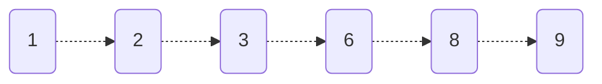
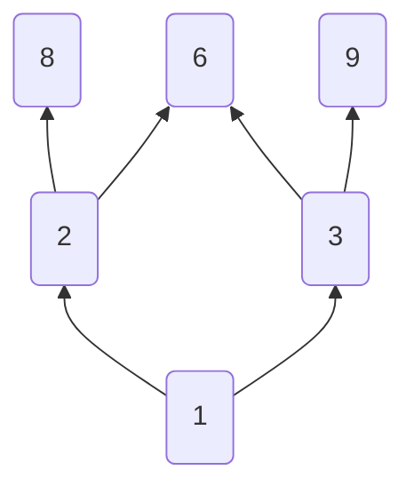
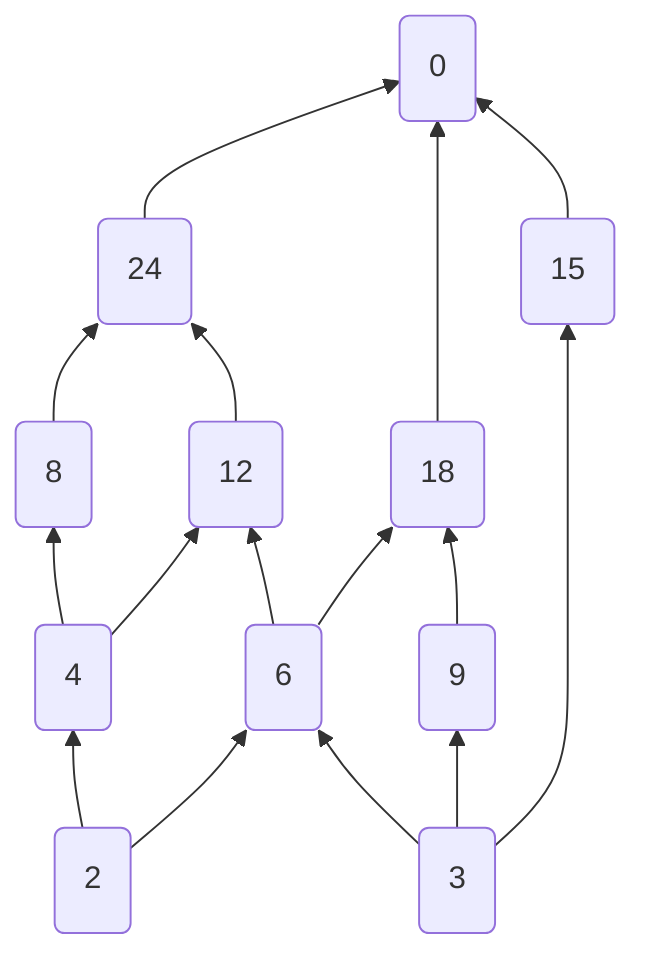
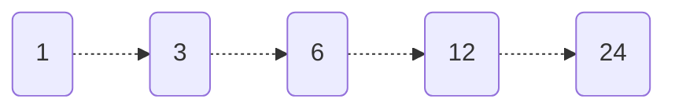
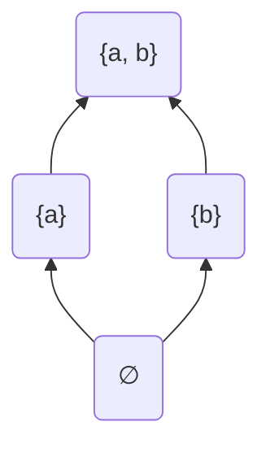
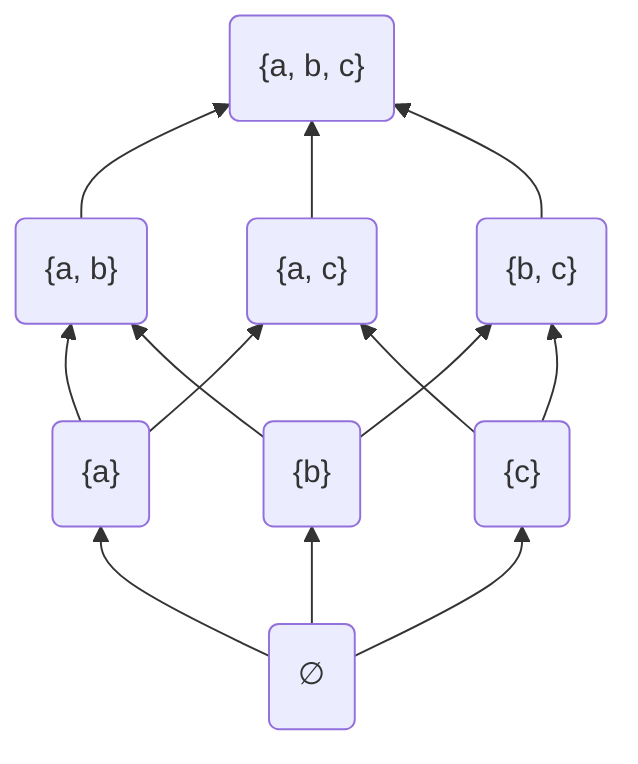
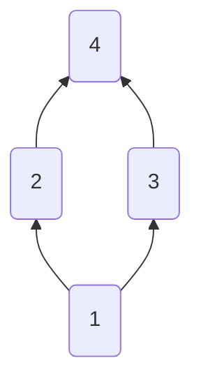
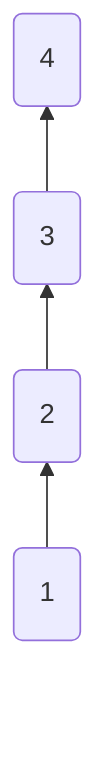

---

````ad-quote
title:

##### **Intro ) -** ...

```ad-quote
title: 
```
````

>[!quote] **Vault:** [YouTube 01](https://youtu.be/3L3NZWOaMrI?si=Q5e3GRXj__yM9H_c)

>[!quote] **Vault:** [YouTube 02](https://www.youtube.com/watch?v=Qze25lQYLhs)

---

```ad-done
title:  

#### **Fase 01 ) - ...**

```

---

````ad-quote
title:

##### **01 ) -** Definição formal

```ad-quote
title:  
Quando estamos trabalhando com conjuntos ordenados que possuem poucos elementos, muitas vezes é vantajoso representar graficamente através de um diagrama construído obedecendo-se certas convenções.

Seja $A$ um conjunto não vazio ordenado pela ordem $\preceq$.
```

```ad-quote
title:
- Os elementos de $A$ são dispostos num plano e sempre que $x \preceq y$ e $x \neq y$, então $x$ (menor) deve ficar abaixo do $y$ (maior).
```

```ad-quote
title:
- Sempre que $x \preceq y$ e $x \neq y$, devemos ligar $x$ e $y$ por uma flecha orientada de $x$ para $y$.
```

```ad-quote
title:
- Se $x \preceq y$, $y \preceq z$, $x \neq y$ e $y \neq z$, então devemos ligar $x$ a $y$ por uma flecha orientada e $y$ a $z$ por uma flecha orientada.
```

```ad-quote
title:
- O fato de $x \prec z$ fica representado pelas duas flechas que ligam $x$ a $y$ e $y$ a $z$.
```
````

---

> [!done] **_New_**

---

````ad-quote
title:

###### **02 ) -** Ordem usual $a \leq b$

```ad-quote
title:
```
````

`````ad-quote
title:

```ad-quote
title:
###### Exemplo 2A )
```

```ad-quote
title:
- $A = \{1,2,3,6,8,9\}$
```

````ad-quote
title:

````
`````

---

> [!done] **_New_**

---

````ad-quote
title:

###### **03 ) -** Ordem da divisibilidade $a \mid y$

```ad-quote
title:
```
````

`````ad-quote
title:

```ad-quote
title:
###### Exemplo 3A )
```

```ad-quote
title:
- $A = \{1,2,3,6,8,9\}$
```

````ad-quote
title:

````
`````

`````ad-quote
title:

```ad-quote
title:
###### Exemplo 3B )
```

```ad-quote
title:
- $B = \{0, 2, 3, 4, 6, 8, 9, 12, 15, 18, 24\}$
```

````ad-quote
title:

````
`````

---

> [!done] **_New_**

---

````ad-quote
title:

###### **04 ) -** Ordem usual divisiva $a \mid b$

```ad-quote
title:
```
````

`````ad-quote
title:

```ad-quote
title:
###### Exemplo 4A )
```

```ad-quote
title:
- $B = \{1,3,6,12,24\}$
```

````ad-quote
title:

````
`````

---

> [!done] **_New_**

---

````ad-quote
title:

###### **05 ) -** Ordem da inclusão $a \subseteq b$ 

```ad-quote
title:
```
````

`````ad-quote
title:

```ad-quote
title:
###### Exemplo 5A )
```

```ad-quote
title:
- Seja $X = \{a, b\}$. Temos o Diagrama de Hasse do conjunto $\wp(X) = \{\emptyset, \{a\}, \{b\}, \{a, b\}\}$
```

````ad-quote
title:

````
`````

`````ad-quote
title:

```ad-quote
title:
###### Exemplo 5B )
```

```ad-quote
title:
- Seja $X = \{a, b, c\}$. Temos o Diagrama de Hasse do conjunto. $\wp(X) = \{\emptyset, \{a\}, \{b\}, \{c\}, \{a, b\}, \{a, c\}, \{b, c\}, \{a, b, c\}\}$
```

````ad-quote
title:

````
`````

---

```ad-done
title:  

#### **Fase 02 ) - ...**

```

---

Elementos maximais minimais máximos e mínimos

---

```ad-done
title:  

#### **Fase 03 ) - ...**

```

---
### **Limitante Superior**

_Definição textual abrangente_

Um _limitante superior_ é um elemento pertencente ao conjunto principal que domina ou encapsula a totalidade do subconjunto escolhido, situando-se em um nível hierárquico estrutural que é igual ou superior a todos os seus componentes simultaneamente. Em uma representação gráfica de ordem parcial, ele atua como um teto estrutural para o qual todos os caminhos direcionados do subconjunto convergem sem exceção.

_Definição formal_ Considere a relação parcialmente ordenada em um conjunto $A$ e um subconjunto $B$ de $A$. Um elemento $a \in A$ é chamado de _limitante superior_ de $B$ se $b \le a$ para todo $b \in B$.

_Analogia_

Considere a estrutura de uma árvore genealógica. Se definirmos um subconjunto formado por você e todos os seus primos de primeiro grau, qualquer ancestral comum a todos os membros deste subconjunto (como os avós em comum, os bisavós, etc.) atua estritamente como um _limitante superior_. Este ancestral é um nó na árvore do qual todos vocês descendem, situando-se hierarquicamente "acima" de todos na mesma linha de relação temporal e genética.

### **Limitante Inferior**

_Definição textual abrangente_

O _limitante inferior_ opera na direção estrutural oposta, servindo como uma base comum ou fundamento para o subconjunto analisado. Trata-se de um elemento do conjunto principal que é obrigatoriamente dominado por todos os componentes do subconjunto, localizando-se em um nível igual ou inferior a eles na relação de ordem. Geometricamente, é o ponto de origem exato do qual é possível alcançar cada membro específico do subconjunto seguindo exclusivamente trajetórias ascendentes.

_Definição formal_ Considere a relação parcialmente ordenada em um conjunto $A$ e um subconjunto $B$ de $A$. Um elemento $a \in A$ é chamado de _limitante inferior_ de $B$ se $a \le b$ para todo $b \in B$.

_Analogia_

Utilizando a mesma estrutura de árvore genealógica descrita anteriormente, suponha que selecionamos um subconjunto restrito formado unicamente por dois irmãos. Um _limitante inferior_ para este grupo, sob a ótica estrita de descendência contínua, seria qualquer indivíduo que descenda de ambos os irmãos simultaneamente. Se esses irmãos não geraram filhos juntos (o que configura o cenário biológico padrão), eles não compartilham nenhum descendente comum nessa linha direta. Logo, este subconjunto biológico em particular não possuiria um _limitante inferior_ na estrutura avaliada.

---

> [!done] **_New_**

---

`````ad-quote
title:
##### Exemplo ... )

```ad-quote
title:
Seja o conjunto $B = \{0, 2, 3, 4, 6, 8, 9, 12, 15, 18, 24\}$ parcialmente ordenado pela relação de divisibilidade, denotada por $\mid$. Determine os limitantes superiores e inferiores para o subconjunto $S = \{4, 6\}$.
```

````ad-quote
title:

````
`````

````ad-quote
title:

```ad-quote
title:
##### Limitantes Superiores
```

```ad-quote
title:
- O subconjunto formado pelos múltiplos de $4$ presentes em $B$ é $\{4, 8, 12, 24, 0\}$.

- O subconjunto formado pelos múltiplos de $6$ presentes em $B$ é $\{6, 12, 18, 24, 0\}$.
```

```ad-quote
title:
O elemento $0$ satisfaz a premissa matemática de forma estrita, uma vez que qualquer inteiro não nulo divide zero ($4 \mid 0$ e $6 \mid 0$). Os limitantes superiores do subconjunto $S$ são os elementos $0, 12$ e $24$.
```
````

````ad-quote
title:

```ad-quote
title:
##### Limitantes Inferiores
```

```ad-quote
title:
- O subconjunto formado pelos divisores de $4$ presentes em $B$ é $\{2, 4\}$.

- O subconjunto formado pelos divisores de $6$ presentes em $B$ é $\{2, 3, 6\}$.
```

```ad-quote
title:
O limitante inferior do subconjunto $S$ é o elemento $2$.
```
````

---

> [!done] **_New_**

---

`````ad-quote
title:
##### Exemplo ... )

```ad-quote
title:
Seja $X = \{a, b, c\}$ e o seu conjunto das partes $\wp(X)$ parcialmente ordenado pela relação de inclusão, denotada por $\subseteq$. Determine os limitantes superiores e inferiores para o subconjunto $S = \{\{a\}, \{b\}\}$.
```

````ad-quote
title:

````
`````

````ad-quote
title:

```ad-quote
title:
##### Limitantes Superiores
```

```ad-quote
title:
- O subconjunto formado pelos elementos de $\wp(X)$ que contêm $\{a\}$ é $\{\{a\}, \{a, b\}, \{a, c\}, \{a, b, c\}\}$.
- O subconjunto formado pelos elementos de $\wp(X)$ que contêm $\{b\}$ é $\{\{b\}, \{a, b\}, \{b, c\}, \{a, b, c\}\}$.
```

```ad-quote
title:
Os limitantes superiores do subconjunto $S$ são os elementos $\{a, b\}$ e $\{a, b, c\}$.
```
````

````ad-quote
title:

```ad-quote
title:
##### Limitantes Inferiores
```

```ad-quote
title:
- O subconjunto formado pelos elementos de $\wp(X)$ que estão contidos em $\{a\}$ é $\{\emptyset, \{a\}\}$.
- O subconjunto formado pelos elementos de $\wp(X)$ que estão contidos em $\{b\}$ é $\{\emptyset, \{b\}\}$.
```

```ad-quote
title:
O único limitante inferior do subconjunto $S$ é o elemento $\emptyset$.
```
````

---

```ad-done
title:  

#### **Fase 04 ) - Ordenação topológica**

```

---
##### Definição

Uma ordenação topológica organiza os elementos de uma ordem parcial em uma sequência linear única, garantindo que cada elemento seja posicionado somente após todos os seus predecessores originais.

##### Estrutura da Relação Parcial

Considere o conjunto $A = \{1, 2, 3, 4\}$. Vamos definir uma relação de ordem parcial $R$ sobre $A$ contendo o seguinte conjunto exato de pares ordenados:

$$R = \{(1,1), (2,2), (3,3), (4,4), (1,2), (1,3), (1,4), (2,4), (3,4)\}$$

O diagrama de Hasse filtra a relação $R$, removendo a reflexividade e a transitividade para plotar apenas a arquitetura essencial. Como $2$ e $3$ são incomparáveis, a estrutura se divide em ramos paralelos.



##### Ordenação Topológica

A ordenação topológica exige que você destrua as ramificações paralelas. Você deve adicionar conexões artificiais ao conjunto $R$ para forçar a comparabilidade de todos os elementos, transformando a ordem parcial em uma ordem total (uma linha contínua).

Para os elementos incomparáveis $2$ e $3$, você é obrigado a inventar uma precedência que não quebre a hierarquia de quem está abaixo ($1$) e de quem está acima ($4$).

Se você escolher arbitrariamente que $2$ vem antes de $3$, a sua ordenação topológica gera uma nova relação sequencial que podemos chamar de $R_{top}$:

$$R_{top} = \{(1,1), (2,2), (3,3), (4,4), (1,2), (1,3), (1,4), (2,3), (2,4), (3,4)\}$$

A inclusão do par $(2,3)$ achata o sistema em uma cadeia estrita: $1 \le 2 \le 3 \le 4$. O diagrama de Hasse dessa ordenação topológica não possui mais ramos paralelos, tornando-se obrigatoriamente uma linha vertical.


