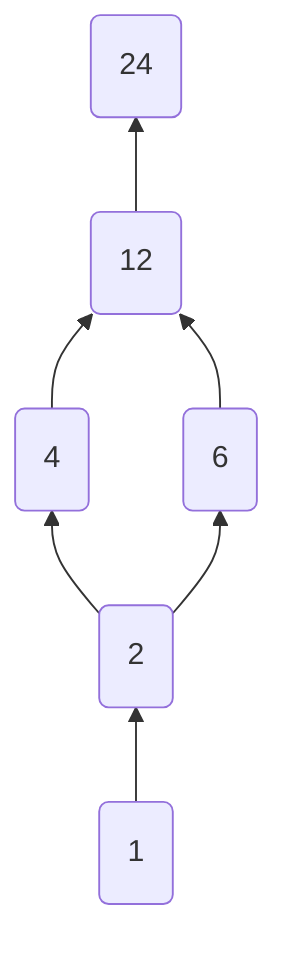
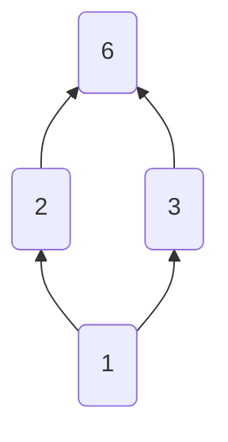
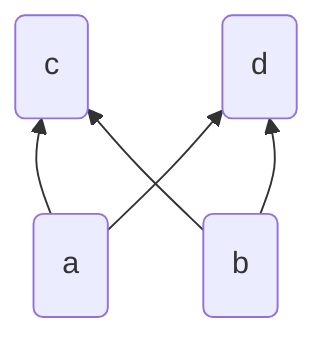
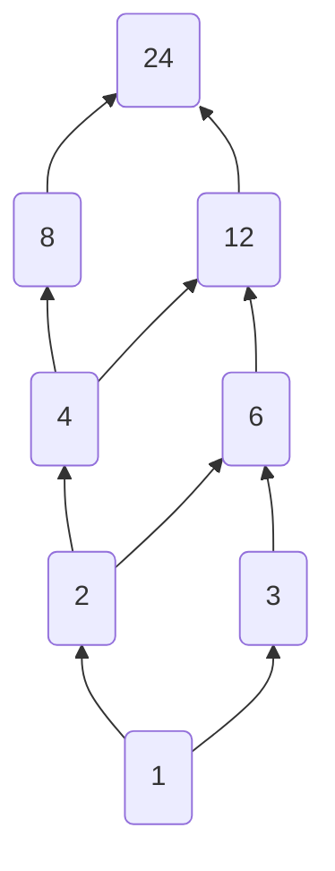

---

````ad-quote
title:

##### **Intro ) -** ...

```ad-quote
title: 
```
````

>[!quote] **Vault:** [YouTube 01]([https://youtu.be/3L3NZWOaMrI?si=Q5e3GRXj__yM9H_c](https://www.youtube.com/watch?v=WpeSWxRHqd8))

---

````ad-quote
title:

##### **01 ) -** Reticulados

```ad-quote
title: 
Um reticulado ou lattice é um conjunto parcialmente ordenado no qual, para absolutamente todo par de elementos $a$ e $b$ contidos nele, existe de forma única e garantida um menor limitante superior e um maior limitante inferior.
```
````

````ad-quote
title:

##### 1.1 ) _Menor Limitante Superior - Supremo_

```ad-quote
title:
Representado pelo operador $\vee$ frequentemente lido como supremo ou join, o elemento $a \vee b$ é o menor limitante superior.
```

```ad-quote
title:
###### Propriedades
```

```ad-quote
title:
- O próprio $a \vee b$ deve atuar como um limitante superior. Logo, é obrigatório que $a \le a \vee b$ e $b \le a \vee b$.
```
```ad-quote
title:
- Se existir um outro limitante superior $c$ para os elementos $a$ e $b$ de forma que $a \le c$ e $b \le c$. Portanto, para que $a \vee b$ seja de fato o supremo obrigatoriamente $a \vee b \le c$
```
````

````ad-quote
title:

##### 1.2 ) _Maior Limitante Inferior - Ínfimo_

```ad-quote
title:
Representado pelo operador $\wedge$ frequentemente lido como ínfimo ou meet, o elemento $a \wedge b$ é o maior limitante inferior:
```

```ad-quote
title:
###### Propriedades
```

```ad-quote
title:
- O próprio $a \wedge b$ deve atuar como um limitante inferior. Logo, é obrigatório que $a \wedge b \le a$ e $a \wedge b \le b$.
```

```ad-quote
title:
- Se existir outro limitante inferior $c$ para os elementos $a$ e $b$ de forma que $c \le a$ e $c \le b$. Portanto, para que $a \wedge b$ seja de fato o ínfimo obrigatoriamente $c \le a \wedge b$
```
````

---

> [!done] **_New_**

---

````ad-quote
title:

##### **2 ) -** Reticulados Limitados

```ad-quote
title:
Um reticulado é classificado matematicamente como _limitado_ quando possui fronteiras universais garantidas. Isso significa a existência de um elemento mínimo absoluto e um elemento máximo absoluto que englobam todos os outros elementos do conjunto.
````

````ad-quote
title:

##### 2.1 ) _O Elemento Mínimo - $0$_

```ad-quote
title:
Representado convencionalmente pelo símbolo $0$, o elemento mínimo absoluto atua como o limite inferior primário de toda a estrutura.
```

```ad-quote
title:
###### Propriedades
```

```ad-quote
title:
- Para qualquer elemento $a$ contido no reticulado, a relação obrigatória de precedência é $0 \le a$. 
```

```ad-quote
title:
- Como o $0$ antecede todos os elementos, o encontro dele com qualquer nó resulta nele mesmo ($a \wedge 0 = 0$), e a junção resulta no elemento testado ($a \vee 0 = a$).
```
````

````ad-quote
title:

##### 2.2 ) O Elemento Máximo - $1$ ou $I$

```ad-quote
title:
Representado pelo símbolo $1$ (ou $I$ em algumas literaturas), o elemento máximo absoluto atua como o limite superior final de toda a estrutura.
```

```ad-quote
title:
###### Propriedades
```

```ad-quote
title:
- Para qualquer elemento $a$ contido no reticulado, a relação obrigatória de subordinação é $a \le 1$.
```

```ad-quote
title:
- Como o $1$ sucede todos os elementos, a junção dele com qualquer nó resulta nele mesmo ($a \vee 1 = 1$), e o encontro resulta no elemento testado ($a \wedge 1 = a$).
```
````

---

> [!done] **_New_**

---

`````ad-quote
title:

##### Exemplo ... )

```ad-quote
title:
O diagrama abaixo utiliza o conjunto de divisibilidade $A = \{1, 2, 4, 6, 12, 24\}$ analisando o par {4,6}.
```
````ad-quote
title:

````
`````

````ad-quote
title:

```ad-quote
title:
###### Menor Limitante Superior - LUB
```
Proposição de limitante superior: 
- O resultado da operação $a \vee b$ é o elemento $12$. Logo, $a \vee b = 12$.
- A regra exige que $a \le a \vee b$ e $b \le a \vee b$. Substituindo as variáveis pela relação de divisibilidade, temos que $4 \mid 12$ e $6 \mid 12$, o que valida o $12$ como o menor limitante superior.

Proposição de extremidade: 
- Introduzimos a variável $c = 24$ como um limitante superior genérico alternativo, pois ele também satisfaz a condição de ser dividido por $4$ e por $6$. A regra de minimalidade dita que $a \vee b \le c$. Substituindo os valores, temos a relação $12$ divide $24$. Isso prova que $a \vee b = 12$ é menor ou igual a qualquer outro teto genérico proposto.
  
````

````ad-quote
title:

```ad-quote
title:
###### Maior Limitante Inferior - GLB
```

Proposição de limitante inferior: 
- O resultado da operação abstrata $a \wedge b$ é o elemento 2. A regra exige que $a \wedge b \le a$ e $a \wedge b \le b$. Verificando os valores, constatamos que 2 divide 4 e 2 divide 6, confirmando sua atuação como limitante inferior.

Proposição de extremidade: 
- Introduzimos a variável $c = 1$ como um limitante inferior genérico concorrente, dado que 1 divide tanto o 4 quanto o 6. A regra de maximalidade exige que $c \le a \wedge b$. Substituindo as variáveis pelos números do diagrama, obtemos que $1 \mid 2$. Isso demonstra que $a \wedge b = 2$ é maior ou igual a qualquer outro candidato.
````

---
##### **Exemplo de Reticulado**



A estrutura acima representa um reticulado. Uma vez que para qualquer subconjunto contendo exatamente dois elementos a relação possui um único menor limitante superior e um único maior limitante inferior.

Analisando o par $\{2, 3\}$, os limitantes superiores são restritos ao elemento 6, que atua obrigatoriamente como o menor deles. Os limitantes inferiores são restritos ao elemento 1, configurando o maior deles. Como essa regra se mantém para qualquer combinação de pares no diagrama, a classificação é formalmente confirmada.

##### **Exemplo de Não Reticulado**



A estrutura acima falha e não é um reticulado. O erro que quebra a exigência da estrutura ocorre ao avaliarmos o subconjunto $\{a, b\}$.

Os limitantes superiores de $a$ e $b$ formam o conjunto $\{c, d\}$. A definição matemática exige que exista um menor limitante superior único. Como os elementos $c$ e $d$ não possuem nenhuma relação hierárquica entre si no diagrama (são estruturalmente incomparáveis), é impossível determinar qual dos dois é hierarquicamente menor. A ausência de um único menor limitante superior para esse par específico desqualifica o diagrama inteiro.

---
##### **Idempotência**

Explicação: Quando você compara um elemento com ele mesmo, a fronteira superior ou inferior não muda. O limite de um número em relação a si próprio é invariavelmente ele mesmo. 

Fórmulas: $a \vee a = a$ $a \wedge a = a$ 

Exemplo numérico: Usando o elemento 4 sob a regra de divisibilidade. $4 \vee 4 = 4$ $4 \wedge 4 = 4$

##### **Comutatividade**

Explicação: A ordem de leitura dos elementos não interfere na operação. O resultado da busca pelos limites é exato independentemente de qual variável você insere primeiro. 

Fórmulas: $a \vee b = b \vee a$ $a \wedge b = b \wedge a$ 

Exemplo numérico: Usando 4 e 6. $4 \vee 6 = 12$ e $6 \vee 4 = 12$ $4 \wedge 6 = 2$ e $6 \wedge 4 = 2$

##### **Associatividade**

Explicação: Ao lidar com três ou mais variáveis conectadas pela mesma operação, a forma como você agrupa os pares iniciais não afeta o cálculo. Você resolve na ordem que preferir e a resposta final se mantém idêntica. 

Fórmulas: $a \vee (b \vee c) = (a \vee b) \vee c$ $a \wedge (b \wedge c) = (a \wedge b) \wedge c$ 

Exemplo numérico: Usando 2, 4 e 6. $2 \vee (4 \vee 6) \implies 2 \vee 12 = 12$ $(2 \vee 4) \vee 6 \implies 4 \vee 6 = 12$

##### **Absorção**

Explicação: Quando você aninha as operações _supremo_ e _ínfimo_ dentro de uma mesma expressão e repete um dos elementos, a estrutura absorve o conjunto inteiro. O cálculo invalida a variável secundária e o resultado trava diretamente no termo repetido. 

Fórmulas: $a \vee (a \wedge b) = a$ $a \wedge (a \vee b) = a$ 

Exemplo numérico: Usando 4 e 6. $4 \vee (4 \wedge 6) \implies 4 \vee 2 = 4$ $4 \wedge (4 \vee 6) \implies 4 \wedge 12 = 4$

##### **Preservação de Ordem**

Explicação: Se uma desigualdade já existe de forma comprovada entre dois elementos, introduzir um terceiro fator idêntico em ambos os lados mantém a relação de ordem intacta. O limite gerado no lado esquerdo continuará sendo menor ou igual ao limite do lado direito. 

Fórmulas: Se $a \le b$, então $a \vee c \le b \vee c$ Se $a \le b$, então $a \wedge c \le b \wedge c$ 

Exemplo numérico: Assuma a premissa válida de que $2 \le 4$, pois o número 2 divide o 4. Insira o fator extra $c = 3$. Para o _supremo_: $2 \vee 3 \le 4 \vee 3 \implies 6 \le 12$. A proposição é verdadeira pois 6 divide 12. Para o _ínfimo_: $2 \wedge 3 \le 4 \wedge 3 \implies 1 \le 1$. A proposição é verdadeira pois 1 divide 1.

##### Equivalência de Ordem

Explicação: Existe uma ligação direta e irredutível entre a ordem hierárquica e o resultado das operações. Se um elemento é hierarquicamente menor ou igual a outro, ele obriga o resultado do _ínfimo_ a ser ele próprio, e o resultado do _supremo_ a ser o elemento maior. 

Fórmulas: $a \le b \iff a \vee b = b$ $a \le b \iff a \wedge b = a$ 

Exemplo numérico: Pegue o 2 e o 4. O 2 divide o 4. Seguindo a regra, $2 \vee 4 = 4$ e $2 \wedge 4 = 2$.

##### Limite Conjunto

Explicação: Se um elemento consegue atuar isoladamente como base inferior para dois itens separados, ele obrigatoriamente também atua como base para a operação de _ínfimo_ formada por esses mesmos itens. 

Fórmula: $c \le a$ e $c \le b \iff c \le a \wedge b$ 

Exemplo numérico: O número 2 divide o 12 e também divide o 24. A operação $12 \wedge 24$ resulta no 12. A afirmação final de que o 2 divide o 12 se mantém intacta.

##### Preservação de Ordem Estendida

Explicação: Você pode operar duas desigualdades simultâneas. Se você extrair o _supremo_ dos dois termos menores, o resultado continuará sendo menor ou igual ao _supremo_ calculado entre os dois termos maiores. A mesma garantia se aplica à operação do _ínfimo_. 

Fórmulas: Se $a \le b$ e $c \le d$, então $a \vee c \le b \vee d$ Se $a \le b$ e $c \le d$, então $a \wedge c \le b \wedge d$ 

Exemplo numérico: Assuma como verdade que $2 \le 4$ e $3 \le 6$. Calculando o _supremo_: $2 \vee 3 \le 4 \vee 6$. O limite de 2 e 3 é 6. O limite de 4 e 6 é 12. A estrutura confirma que 6 divide 12.


---



B = {4,6}

Múltiplos de 4 em B {1,2,4,8,12,24}
Múltiplos de 6 em B {1,3,6,12,24}

Subconjunto: $B = \{4, 6\}$

Limitantes superiores de B: Elementos de A que são divisíveis por 4 e por 6 simultaneamente.
Conjunto de limitantes superiores: $\{12, 24\}$
Menor limitante superior: 12

Limitantes inferiores de B: Elementos de A que dividem 4 e 6 simultaneamente.
Conjunto de limitantes inferiores: $\{1, 2\}$
Maior limitante inferior: 2

Menor limitante superior: 12
Maior limitante inferior: 2

