---
Pg 1 ) Q1 - LA

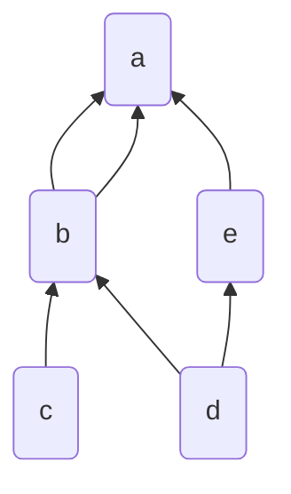

Mínimos: $\varnothing$
Minimais: {c, d}
Máximos: {a}
Maximais: {a}

---
Pg 2 ) Q1 - LB

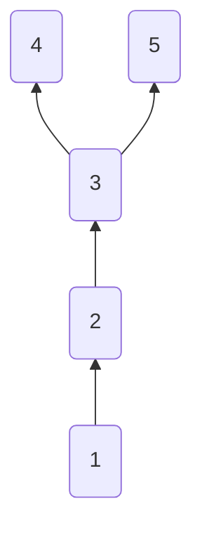

Mínimos: {1}
Minimais: {1}
Máximos: $\varnothing$
Maximais: {4, 5}

---
Pg 2 ) Q1 - LC

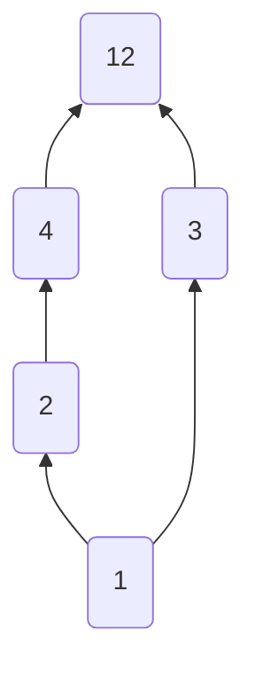
Mínimos: {1}
Minimais: {1}
Máximos: {12}
Maximais: {12}

---
Pg 2 ) Q1 - LD

- $R = \subseteq$ e $A$ é o conjunto das partes de $\{a, b, c, d\}$.

Pela definição formal, o conjunto das partes $\mathcal{P}(A)$ possui obrigatoriamente $2^4 = 16$ elementos, englobando todas as combinações de cardinalidade de $0$ a $4$. Logo, $\mathcal{P}(A) = \{\varnothing, \{a\}, \{b\}, \{c\}, \{d\}, \{a,b\}, \{a,c\}, \{a,d\}, \{b,c\}, \{b,d\}, \{c,d\}, \{a,b,c\}, \{a,b,d\}, \{a,c,d\}, \{b,c,d\}, \{a,b,c,d\}\}$

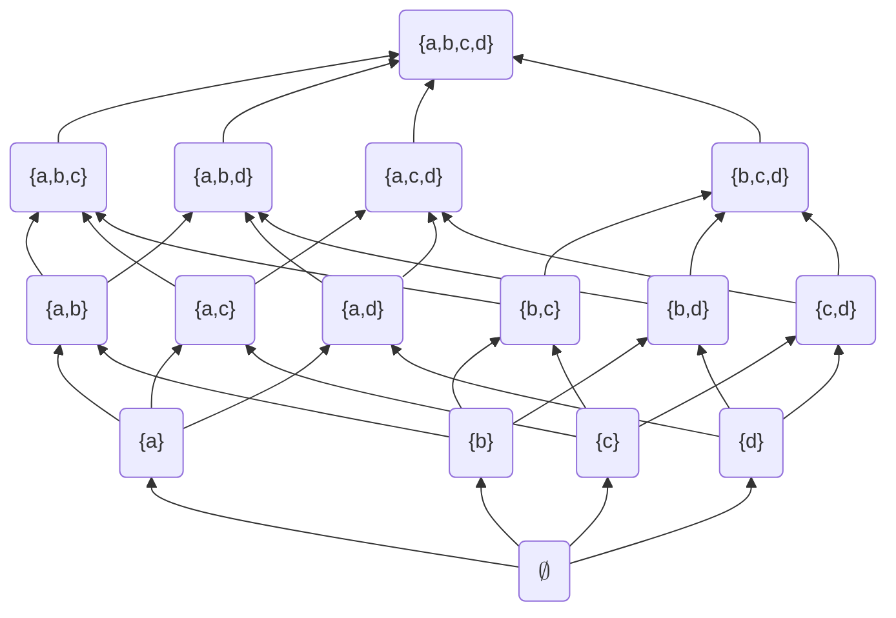

Mínimos: $\varnothing$
Minimais: $\varnothing$
Máximos: $\{a,b,c,d\}$
Maximais: $\{a,b,c,d\}$

---
Pg 2 ) Q1 - LE

- $A = \{1, 2, 3, 4, 5\}$ e $R = \iota_A \cup \{(a,c), (a,d), (a,e), (b,a), (b,c), (b,d), (b,e), (c,d)\}$

---

> [!done] **_New_**

---

Pg 7 ) Q1 - LA

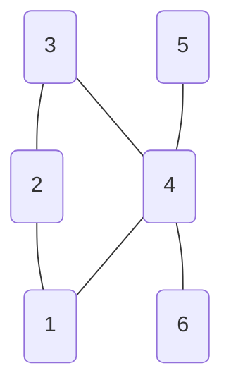

A = {2, 3, 4, 6, 8, 24, 48}, com relação de divisibilidade.

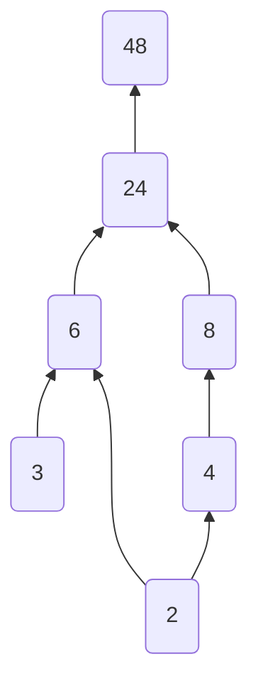

---

> [!done] **_New_**

---

01JUN - Pg 5 ) Q2

Com as propriedades da álgebra booleana simplifique os termos da expressão abaixo:

$((x \wedge y') \vee ((x \wedge 0) \vee (x' \wedge 1)))'$

$\Rightarrow ((x \wedge y') \vee (0 \vee x'))'$ (Pela _lei da dominação_ em $x \wedge 0$ e _lei da identidade_ em $x' \wedge 1$)

$\Rightarrow ((x \wedge y') \vee x')'$ (Pela _lei da identidade_, resolvendo $0 \vee x'$)

$\Rightarrow (x \wedge y')' \wedge (x')'$ (Pela _lei de De Morgan_ aplicada ao complemento mais externo)

$\Rightarrow (x' \vee (y')') \wedge x$ (Pela _lei de De Morgan_  e _lei da dupla negação_)

$\Rightarrow (x' \vee y) \wedge x$ (Pela _lei da dupla negação_ em $y$)

$\Rightarrow (x' \wedge x) \vee (y \wedge x)$ (Pela _lei distributiva_)

$\Rightarrow 0 \vee (y \wedge x)$ (Pela _lei da complementação_)

$\Rightarrow x \wedge y$ (Pela _lei da identidade_ e propriedade _comutativa_)

---
01JUN - Pg 5 ) Q3

Considere o operador $\odot$ definido abaixo em uma álgebra booleana:
- $x \odot y =_{def} (x \vee y') \wedge (x' \vee y)$
Demonstre que:
- $x \odot y = (x \wedge y) \vee (x' \wedge y')$

Demonstração:

$(x \vee y') \wedge (x' \vee y)$

=> $((x \vee y') \wedge x') \vee ((x \vee y') \wedge y))$ (Pela lei da distributividade)

=> $((x \wedge x') \vee (y' \wedge x')) \vee ((x \wedge y) \vee (y' \wedge y))$ (Pela lei da distributividade)

=> $(0 \vee (y' \wedge x')) \vee ((x \wedge y) \vee 0)$ (Pela lei do complemento)

=> $(y' \wedge x') \vee (x \wedge y)$ (Pela lei da identidade)

=> $(x \wedge y) \vee (y' \wedge x')$ (Pela lei da comutatividade)

Portanto, está provado que a proposição é verdadeira.

---
01JUN - Pg 5 ) Q7

Demonstre na algebra booleana que $b ∧ (a ∨ (a′ ∧ (b ∨ b′))) = b$

Demostração:

$b ∧ (a ∨ (a′ ∧ (b ∨ b′)))$

=> $b ∧ (a ∨ (a′ ∧ 1))$ (Pela lei do complemento)

=> $b ∧ (a ∨ a′))$ (Pela lei da identidade)

=> $b ∧ 1$ (Pela lei do complemento)

=> $b$ (Pela lei da identidade)

Portanto, está provado que a proposição é verdadeira.

---
01JUN - Pg 5 ) Q8

Demonstre na algebra booleana que $((a ∨ c) ∧ (b′ ∨ c))′ = (a′ ∨ b) ∧ c′$

$((a \vee c) \wedge (b' \vee c))'$

$\Rightarrow ((a \wedge b') \vee c)'$ (Pela lei da distributividade)

$\Rightarrow (a \wedge b')' \wedge c'$ (Pela lei de De Morgan)

$\Rightarrow (a' \vee b) \wedge c'$ (Pela lei de De Morgan)

---
01JUN - Pg 5 ) Q9

Seja $A = \{1,2,3,4\}$ e $R = \{(1,1),(1,2),(2,2),(3,3),(4,4),(1,4)\}$

Desenhe o diagrama de Hasse da relação de ordem parcial definida por $R$

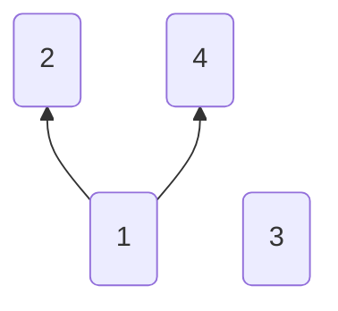

---
01JUN - Pg 6 ) Q10

Descreva a ordem parcial na relação determinada pelo diagrama de Hasse do conjunto $A$ mostrado na Figura 7.14

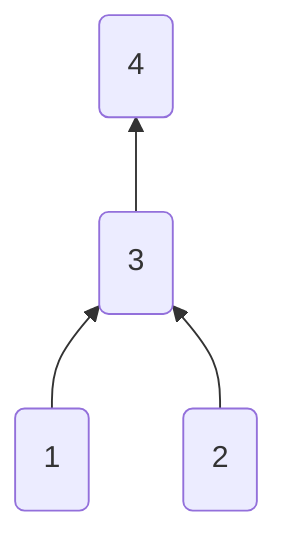
Resposta:
- Uma relação de ordem parcial tem que ser obrigatoriamente reflexiva, anti-simétrica e transitiva. Portanto, pela definição formal de relação parcial:

$R = \{(1,1),(2,2),(3,3),(4,4),(1,3),(1,4),(2,3),(3,4),(2,4)\}$

---
01JUN - Pg 6 ) Q11

Descreva a ordem parcial na relação determinada pelo diagrama de Hasse do conjunto $A$ mostrado na Figura 7.15

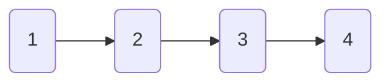
Resposta:
- Uma relação de ordem parcial tem que ser obrigatoriamente reflexiva, anti-simétrica e transitiva. Portanto, pela definição formal de relação parcial:

$R = \{(1,1),(2,2),(3,3),(4,4),(1,2),(1,3),(1,4),(2,3),(2,4),(3,4)\}$

---

> [!done] **_New_**

---

```ad-quote
title:
###### 01JUN - Pg 7 ) Q14
```

Enunciado:
- Desenhe o diagrama de Hasse da relação total resultante após aplicar a ordenação topológica à relação parcial representada no diagrama abaixo.

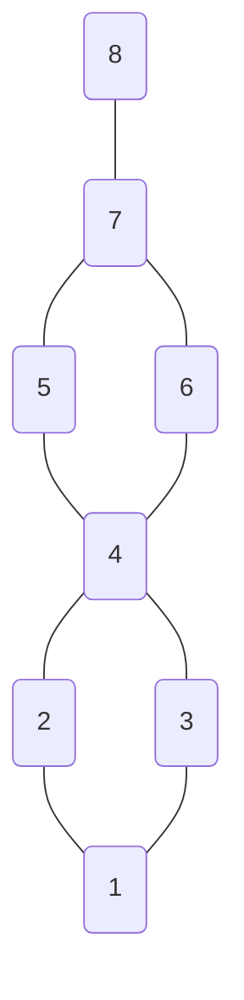

Resposta:
- O diagrama de Hasse resultante após aplicar a ordenação topológica no conjunto parcialmente ordenado é

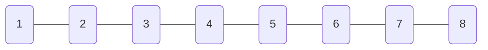

---

> [!done] **_New_**

---

```ad-quote
title:
###### 01JUN - Pg 7 ) Q15
```

Enunciado
- Desenhe o diagrama de Hasse da relação total resultante após aplicar a ordenação topológica à relação parcial representada no diagrama abaixo.

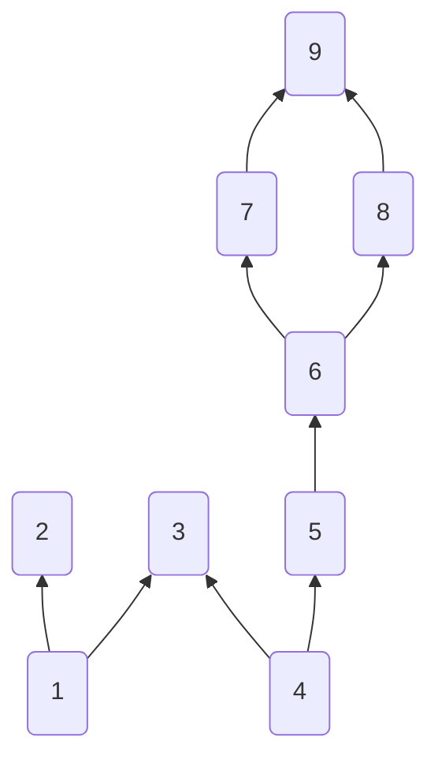
Resposta:
- O diagrama de Hasse resultante após aplicar a ordenação topológica no conjunto parcialmente ordenado é

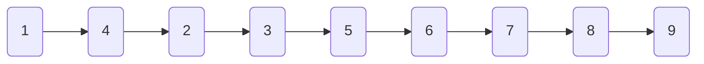

---

> [!done] **_New_**

---

```ad-quote
title:
###### 01JUN - Pg 8 ) Q1
```

Nos exercícios abaixo determine todos os elementos maximais e minimais do conjunto parcialmente ordenado.
###### Letra A
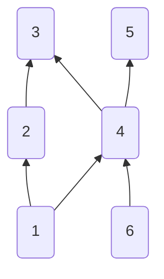
Mínimos: $\varnothing$
Minimais: {1, 6}
Máximos: $\varnothing$
Maximais: {3,5}

---
###### Letra B
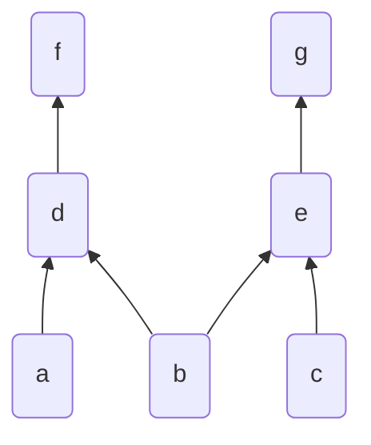
Mínimos: $\varnothing$
Minimais: {a,b,c}
Máximos: $\varnothing$
Maximais: {f,g}

---

> [!done] **_New_**

---

```ad-quote
title:
###### 01JUN - Pg 8 ) Q2
```

Nos exercícios abaixo determine todos os elementos maximais e minimais do conjunto parcialmente ordenado.
###### Letra B
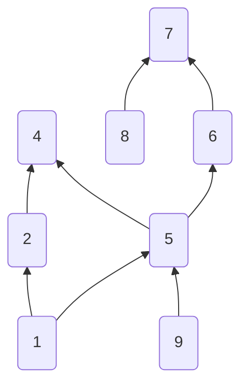
Mínimos: $\varnothing$
Minimais: {1,8,9}
Máximos: $\varnothing$
Maximais: {4,7}

---

> [!done] **_New_**

---

Elemento Máximo: Um elemento $a \in A$ é o máximo se, e somente se, $\forall x \in A$, a premissa $x \le a$ for verdadeira.

Elemento Maximal: Um elemento $a \in A$ é maximal se, e somente se, $\forall x \in A$, a premissa $a \le x \implies a = x$ for verdadeira.

Elemento Mínimo: Um elemento $a \in A$ é o mínimo se, e somente se, $\forall x \in A$, a premissa $a \le x$ for verdadeira.

Elemento Minimal: Um elemento $a \in A$ é minimal se, e somente se, $\forall x \in A$, a premissa $x \le a \implies x = a$ for verdadeira.

---

> [!done] **_New_**

---

```ad-quote
title:
###### 01JUN - Pg 8 ) Q3
```

$A = R$ com a ordem parcial usual $≤$.

Elemento maximal:

- Para $x$ ser o elemento maximal 

---

> [!done] **_New_**

---

```ad-quote
title:
###### 01JUN - Pg 8 ) Q3
```


_Objetivo:_ Determinar e justificar o maximal e minimal no conjunto $A = \{x \in \mathbb{R} \mid 0 < x < 1\}$.

Elemento Maximal
- Não existe.

- Para existir um maximal, ele precisaria ser o "maior de todos". Chame esse suposto maximal de $x$. Como o limite superior do conjunto é aberto ($x < 1$), se você calcular a média entre esse $x$ e o limite $1$ (fazendo $\frac{x + 1}{2}$), o resultado ainda pertencerá ao conjunto, mas será _estritamente maior_ que o próprio $x$. Como a regra permite fazer essa média infinitamente, a existência de um teto rígido dentro do conjunto é impossível.


Elemento Minimal
- Não existe.

- Para existir um minimal, ele seria o "menor de todos". Chame esse suposto minimal de $x$. Como o conjunto é restrito aos números maiores que zero ($x > 0$), se você dividir esse $x$ pela metade ($\frac{x}{2}$), o resultado continuará sendo maior que zero, mas será _estritamente menor_ que o próprio $x$. Como essa quebra pela metade pode ser feita infinitamente sem sair de $A$, a existência de um piso rígido é impossível.


---

> [!done] **_New_**

---

```ad-quote
title:
###### 01JUN - Pg 8 ) Q4
```

###### Letra A

Determinar e justificar o maximal e minimal no conjunto $A = \{x \in \mathbb{R} \mid 0 < x \le 1\}$.

**Elemento Maximal**

- O maximal é $1$.

- A regra do conjunto define que todo elemento deve ser $\le 1$. Como o número $1$ atende a essa regra, ele faz parte de $A$. Portanto, é logicamente impossível achar um número maior que $1$ dentro deste limite.

**Elemento Minimal**

- Não existe.

- Para existir um minimal, ele seria o "menor de todos". Chame esse suposto minimal de $x$. Como o conjunto é de números maiores que zero, $x > 0$. Se você dividir esse $x$ pela metade ($\frac{x}{2}$), o resultado ainda será maior que zero, mas será estritamente menor que o próprio $x$. Como sempre será possível encontrar essa metade menor dentro de $A$, a existência de um número minimal é impossível.

---

> [!done] **_New_**

---

```ad-quote
title:
###### 01JUN - Pg 8 ) Q9
```

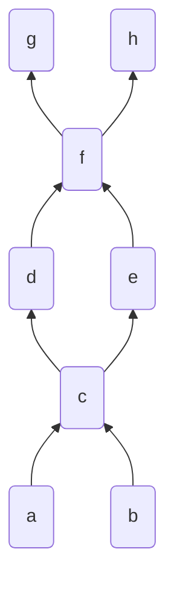

Limitantes superiores de $B = \{f,g,h\}$

supremo de de $B = f$

Limitantes inferiores de $B = \{c,a,b\}$

ínfimo de de $B = c$

Teorema 1 (Teorema 2 do livro). $L$ um reticulado. Para todo $a$ e $b$ em $L$,  
$(a) a ∨ b = b sse a ≤ b$. 
$(b) a ∧ b = a sse a ≤ b$. 
$(c) a ∧ b = a sse a ∨ b = b$.

---
---

**21.** Seja $L$ um reticulado distributivo. Mostre que, se existe um $a$ com $a \wedge x = a \wedge y$ e $a \vee x = a \vee y$, então $x = y$.

Hip - $a \wedge x = a \wedge y$
Hip - $a \vee x = a \vee y$

Demonstração Ida:

$x$ 
=> $x \wedge (x \vee a)$ (Absorção)
=> $x \wedge (a \vee x)$ (Comutatividade)
=> $x \wedge (a \vee y)$ (Hip)
=> $(x \wedge a) \vee (x \wedge y)$ (Distributividade)
=> $(a \wedge x) \vee (x \wedge y)$ (Comutatividade)
=> $(a \wedge y) \vee (x \wedge y)$ (Hip)
=> $y \wedge (a \vee x)$ (Distributividade)
=> $y \wedge (a \vee y)$ (Hip)
=> $y \wedge (y \vee a)$ (Comutatividade)
=> $y$ (Absorção)

A demostração da volta é análoga a da IDA.

---
---

**19.** Mostre que se $a \le (b \wedge c)$ para alguns $a, b$ e $c$ em um poset $L$, então as propriedades distributivas de um reticulado são satisfeitas por $a, b$ e $c$.

Mostre que: $a \leq b$

Hip - $a \le (b \wedge c)$

$a \leq b$
=> $a \vee b = b$


