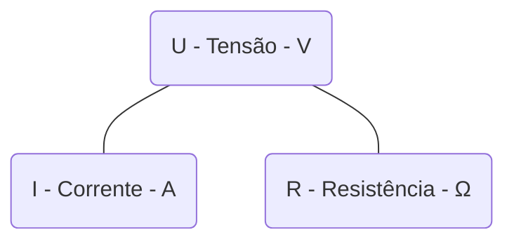

---
**01 ) Corrente Elétrica**

A corrente mede a quantidade de carga que passa por um fio em um certo tempo.

$$i = \frac{\Delta q}{\Delta t}$$

1. A letra $i$ representa a corrente medida em ampères (A).
2. O símbolo $\Delta q$ indica a carga elétrica medida em coulombs (C).
3. O símbolo $\Delta t$ mostra o intervalo de tempo medido em segundos (s).

---
**02 ) Leis de Ohm**

**2.1 )** Primeira Lei de Ohm

- A Primeira Lei relaciona tensão, resistência e corrente. Ela mostra como a energia é consumida pelo obstáculo do fio.

$$U = R \cdot i$$

1. A letra $U$ é a tensão medida em volts (V).
2. A letra $R$ é a resistência medida em ohms (Ω).
3. A letra $i$ é a corrente medida em ampères (A).

**2.2 )** Segunda Lei de Ohm

- A Segunda Lei calcula a resistência com base no material e no formato físico do fio.

$$R = \rho \cdot \frac{L}{A}$$

1. O símbolo $\rho$ representa a resistividade do material medida em ohm metro (Ω·m).
2. A letra $L$ é o comprimento do fio medido em metros (m).
3. A letra $A$ é a área da espessura do fio medida em metros quadrados (m²).

---
**03 ) Potência Elétrica**

A potência geral indica o quão rápido a energia elétrica é transformada no circuito.

$$P = U \cdot i$$

1. A letra $P$ é a potência medida em watts (W).
2. A letra $U$ é a tensão medida em volts (V).
3. A letra $i$ é a corrente medida em ampères (A).

---
**04 ) Energia Elétrica Consumida**

Essa equação calcula o gasto de energia ao longo de um período. Ela é a base para o cálculo da sua conta de luz residencial.

$$E = P \cdot \Delta t$$

1. A letra $E$ representa a energia elétrica consumida medida em joules (J) ou quilowatt hora (kWh).
2. A letra $P$ é a potência medida em watts (W).
3. O símbolo $\Delta t$ mostra o intervalo de tempo medido em segundos (s) ou horas (h).

---
**05 ) Potência Elétrica Dissipada em um Resistor**

Essa regra calcula a energia que um resistor transforma em calor. Nós temos duas opções de cálculo para situações práticas diferentes.

**5.1 ) Potência com Foco na Corrente**

- Essa primeira equação é ideal quando nós sabemos o valor da corrente elétrica. Ela ajuda bastante na análise de componentes ligados na mesma linha.

$$P = R \cdot i^2$$

1. A letra $P$ é a potência medida em watts (W).
2. A letra $R$ é a resistência medida em ohms (Ω).
3. A letra $i$ é a corrente medida em ampères (A).

**5.2 ) Potência com Foco na Tensão**

- Essa segunda equação é a melhor escolha quando nós conhecemos a tensão elétrica. Ela simplifica a resolução para aparelhos ligados de forma independente na tomada.

$$P = \frac{U^2}{R}$$

1. A letra $P$ é a potência medida em watts (W).
2. A letra $U$ é a tensão medida em volts (V).
3. A letra $R$ é a resistência medida em ohms (Ω).

---
**06 ) Circuito Elétrico**

Em circuitos nós juntamos as resistências para achar o valor total do sistema.

**6.1 ) Associação em Série**

- Para obstáculos ligados na mesma linha em sequência nós usamos a soma simples.

$$R_{eq} = R_1 + R_2 + R_3$$

1. O símbolo $R_{eq}$ representa a resistência equivalente total medida em ohms (Ω).
2. Os símbolos $R_1$, $R_2$ e $R_3$ indicam as resistências individuais medidas em ohms (Ω).

**6.2 ) Associação em Paralelo**

- Para obstáculos ligados lado a lado de forma independente nós somamos os valores invertidos.

$$\frac{1}{R_{eq}} = \frac{1}{R_1} + \frac{1}{R_2} + \frac{1}{R_3}$$

1. O símbolo $R_{eq}$ representa a resistência equivalente total medida em ohms (Ω).
2. Os símbolos $R_1$, $R_2$ e $R_3$ indicam as resistências individuais medidas em ohms (Ω).

---
---
**01 Corrente Elétrica**

A ) Um fio de cobre recebe uma carga de 20 coulombs em 5 segundos. Qual é o valor da corrente elétrica no material?
4 ampères

B ) Um aparelho eletrônico funciona com uma corrente de 2 ampères. Determine a quantidade total de carga que passa por ele durante 10 segundos.
20 coulombs

C ) Uma bateria fornece uma corrente constante de 5 ampères para um motor. Quanto tempo demora para que uma carga de 50 coulombs passe pelo circuito?
10 segundos

D ) A parte interna de um fio recebe 120 coulombs de carga durante 60 segundos. Calcule a corrente elétrica gerada.
2 ampères

E ) Um equipamento registra uma carga de 15 coulombs em 3 segundos. Qual é a intensidade da corrente correspondente?
5 ampères

---
**2.1 Primeira Lei de Ohm**

A ) Um resistor de 10 ohms é conectado a uma bateria de 50 volts. Qual é a corrente elétrica que percorre esse componente?
5 ampères

B ) Um circuito elétrico possui uma corrente de 3 ampères. A resistência do fio é de 15 ohms. Determine o valor da tensão aplicada.
45 volts

C ) Um aparelho funciona ligado em uma tomada de 120 volts. Ele puxa uma corrente de 4 ampères. Qual é a resistência interna desse equipamento?
30 ohms

D ) Uma lâmpada comum tem resistência de 60 ohms. Ela recebe uma tensão de 240 volts. Calcule a intensidade da corrente que passa por ela.
4 ampères

E ) Um chuveiro elétrico apresenta corrente de 20 ampères. A resistência do equipamento mede 11 ohms. Descubra a tensão da rede elétrica conectada a ele.
220 volts

---
**2.2 Segunda Lei de Ohm**

A ) Um fio tem 100 metros de comprimento e área de 2 metros quadrados. A resistividade do material é 4. Calcule a resistência total.
200 ohms

B ) Um cabo condutor apresenta uma resistência de 50 ohms. Ele tem 200 metros de comprimento e resistividade igual a 5. Determine a área da seção desse cabo.
20 metros quadrados

C ) Um fio possui comprimento de 10 metros e área de 2 metros quadrados. A resistividade mede 6. Calcule a resistência do material.
30 ohms

D ) A resistência de um fio mede 40 ohms. A sua área vale 3 metros quadrados e o comprimento mede 60 metros. Calcule a resistividade.
2 ohms metro

E ) Um fio cilíndrico possui resistividade 2 e área de 5 metros quadrados. A resistência final é de 10 ohms. Calcule o comprimento da peça.
25 metros

---
**03 Potência Elétrica**

A ) Um motor elétrico é alimentado por uma rede de 220 volts. A corrente consumida mede 10 ampères. Qual é a potência elétrica do aparelho?
2200 watts

B ) Uma lâmpada indica uma potência de 24 watts na embalagem. Ela funciona em uma tensão de 12 volts. Calcule a corrente elétrica necessária para ligar o componente.
2 ampères

C ) Um carregador opera com uma potência constante de 25 watts. A corrente de saída atinge 5 ampères. Determine a tensão fornecida ao aparelho.
5 volts

D ) Um aquecedor consome 15 ampères de corrente elétrica. A tensão da tomada mede 110 volts. Encontre o valor total da potência do equipamento.
1650 watts

E ) Uma televisão exige 120 watts de potência para funcionar. A tensão de alimentação é de 120 volts. Descubra a intensidade da corrente elétrica do circuito.
1 ampère

---
**04 Energia Elétrica Consumida**

A ) Um sistema de refrigeração de 2000 watts fica ligado durante 8 horas seguidas. Calcule o consumo total de energia.
16000 watt hora

B ) Um ferro de passar roupa com potência de 1000 watts é usado por 2 horas diárias. Determine a energia elétrica consumida no final de um dia.
2000 watt hora

C ) Um computador exige 300 watts de potência. Ele permanece ligado durante 5 horas. Qual é o gasto de energia desse equipamento?
1500 watt hora

D ) Uma máquina de lavar trabalha com potência de 1500 watts durante 2 horas. Encontre o valor da energia total utilizada no processo.
3000 watt hora

E ) Um aquecedor de 5000 watts é ligado diariamente por 3 horas. Calcule a energia elétrica consumida ao longo de um dia.
15000 watt hora

---
**5.1 Potência Elétrica Dissipada com Foco na Corrente**

A ) Um resistor de 20 ohms é percorrido por uma corrente de 3 ampères. Qual é a potência transformada em calor pelo componente?
180 watts

B ) Um cabo de transmissão possui resistência de 5 ohms. A corrente que passa por ele atinge 10 ampères. Calcule a energia dissipada por efeito térmico.
500 watts

C ) Um fio tem 50 ohms de resistência. Uma corrente de 2 ampères circula pela peça. Determine a potência exata dissipada no processo.
200 watts

D ) Um circuito de aquecimento usa um resistor de 100 ohms. A corrente medida marca 4 ampères. Encontre a potência térmica gerada.
1600 watts

E ) Um fusível possui resistência interna de 2 ohms. A corrente elétrica chega a 15 ampères antes do rompimento. Calcule a potência dissipada no momento limite.
450 watts

---
**5.2 Potência Elétrica Dissipada com Foco na Tensão**

A ) Um aquecedor de água tem uma resistência interna de 40 ohms. Ele é ligado diretamente em uma tomada de 200 volts. Qual é a potência gerada pelo aparelho?
1000 watts

B ) Uma grelha elétrica apresenta resistência de 25 ohms. A tensão de alimentação mede 100 volts. Calcule a potência térmica dissipada pelo equipamento.
400 watts

C ) Um resistor de cerâmica possui 10 ohms e suporta uma tensão máxima de 50 volts. Determine a potência limite de funcionamento dessa peça.
250 watts

D ) Um aparelho funciona conectado a uma rede de 20 volts. A resistência interna mede 2 ohms. Encontre o valor da potência dissipada.
200 watts

E ) Uma estufa industrial recebe tensão de 300 volts. A resistência dos painéis mede 150 ohms. Calcule a potência térmica total do sistema.
600 watts

---
**6.1 Associação em Série**

A ) Três resistores de 10 ohms 15 ohms e 25 ohms estão ligados na mesma linha. Qual é o valor da resistência equivalente desse circuito?
50 ohms

B ) Um estudante conecta quatro lâmpadas iguais em sequência. Cada lâmpada possui resistência de 5 ohms. Calcule a resistência total do arranjo.
20 ohms

C ) Um circuito tem dois resistores em série. O valor total medido atinge 50 ohms. O primeiro resistor mede 20 ohms. Determine o valor do segundo componente.
30 ohms

D ) Uma fita de luzes decorativas possui 10 pequenas resistências de 2 ohms conectadas em sequência. Calcule o valor equivalente desse trecho.
20 ohms

E ) Um aparelho usa três componentes seguidos com valores de 100 ohms 200 ohms e 300 ohms. Encontre a resistência equivalente final dessa parte.
600 ohms

---
**6.2 Associação em Paralelo**

A ) Dois resistores de 20 ohms e 30 ohms são conectados lado a lado de forma independente. Calcule o valor exato da resistência equivalente.
12 ohms

B ) Um circuito divide a energia para três lâmpadas idênticas de 60 ohms ligadas em paralelo. Determine a resistência total desse conjunto.
20 ohms

C ) Dois componentes de 50 ohms são instalados em paralelo. Descubra a resistência equivalente da rede.
25 ohms

D ) Um técnico liga dois resistores de 10 ohms em conexões paralelas. Encontre a resistência equivalente desse nó específico.
5 ohms

E ) Um sistema possui dois resistores em paralelo. O primeiro tem 12 ohms e o segundo tem 6 ohms. Calcule a resistência equivalente final.
4 ohms

---