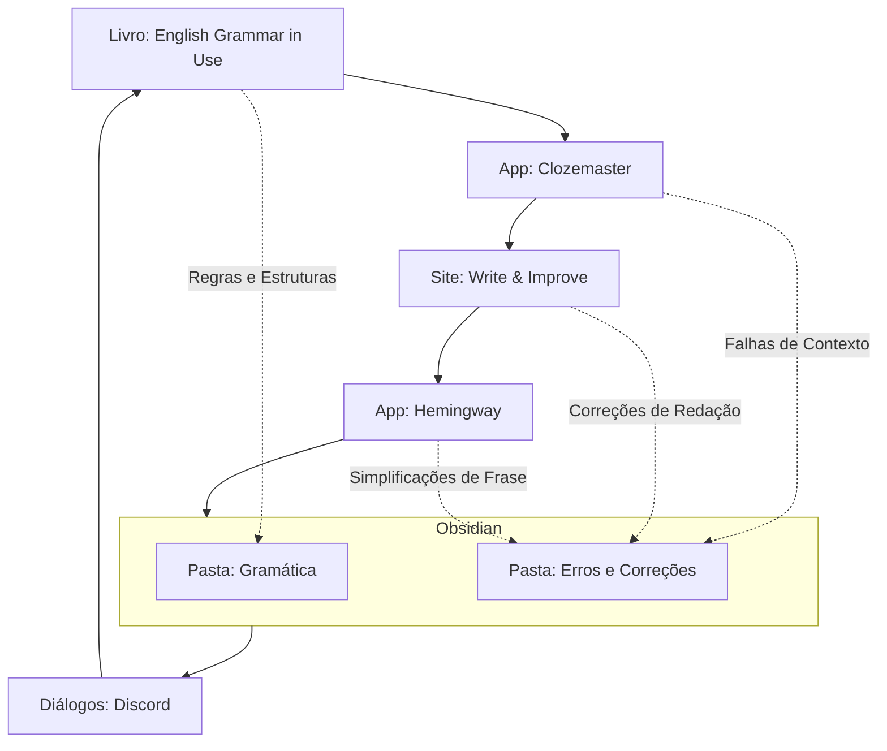

---

https://hemingwayapp.com/
https://writeandimprove.com/workbooks#/wi-workbooks
https://www.clozemaster.com/l/eng-por



---

```ad-done
title:  

#### **Fase 1 )** - A Linha do Tempo
```

---

```ad-quote
title: 
Esta etapa foca nos tempos verbais essenciais. O objetivo é garantir que você saiba organizar os eventos de forma cronológica sem confusão.
```

---
#### **01 ) -** Present and past

```ad-quote
title: **Def**
**Summary:**
- 
```

> [!quote] **Vault:** [[🇬🇧 - Present and past]]

---

> [!done] _New_

---
#### **02 ) -** Present perfect and past

```ad-quote
title: **Def**
**Summary:**
- 
```

> [!quote] **Vault:** [[🇬🇧 - Present perfect and past]]

---

> [!done] _New_

---
#### **03 ) -** Future

```ad-quote
title: **Def**
**Summary:**
- 
```

> [!quote] **Vault:** [[🇬🇧 - Future]]

---

```ad-done
title:  

#### **Fase 1 )** - Intenção e Interação
```

---

Neste bloco o foco muda da descrição de fatos para a expressão de ideias. Você treina como comunicar desejos, obrigações e formular dúvidas claras.

- **Modals**
- **If and wish**
- **Questions and auxiliary verbs**

### **Fase 3: Construção de Textos Complexos**

Esta é a virada estrutural para o nível avançado. Você consolida a habilidade de conectar frases independentes e aprende a relatar informações de terceiros de forma fluida.

- **Passive**
- **Reported speech**
- **-ing and to ...**
- **Relative clauses**

### **Fase 4: Polimento e Exatidão**

A reta final ataca os detalhes gramaticais finos. O estudo dessas classes de palavras serve para refinar a sua escrita e eliminar falhas de conexão.

- **Articles and nouns**
- **Pronouns and determiners**
- **Adjectives and adverbs**
- **Conjunctions and prepositions**
- **Prepositions**
- **Phrasal verbs**