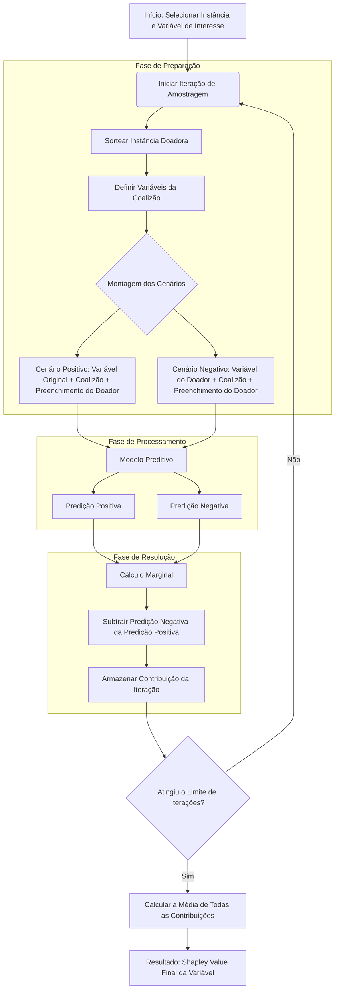

---
Players

Game 

Payout

An intuitive way to understand the Shapley value is the following illustration: The feature values enter a room in random order. All feature values in the room participate in the game (= contribute to the prediction). The Shapley value of a feature value is the average change in the prediction that the coalition already in the room receives when the feature value joins them.


### Classe 1: Entidades de Origem

_Elementos estáticos que fornecem a matéria-prima e os dados brutos para o sistema._

- _Alvo (Instância de Interesse)_: A linha de dados original e fixa que o sistema tenta explicar. Representa a observação real da qual queremos extrair a justificativa da previsão final.
    
- _Variável de Interesse (Feature Alvo)_: A característica específica do alvo cujo peso numérico exato está sendo medido e isolado pelo algoritmo.
    
- _Doador (Instância de Referência)_: A linha de dados aleatória, sorteada da base original, que serve exclusivamente como fonte de valores para preencher os buracos estruturais deixados pelas variáveis ausentes na simulação.
    

### Classe 2: Estruturas de Contexto e Simulação

_Matrizes e subconjuntos montados mecanicamente para isolar a variável no ambiente de teste._

- _Coalizão_: O subconjunto de características do alvo que o algoritmo decide manter estático durante uma rodada. Serve para montar o contexto matemático onde a variável de interesse será testada.
    
- _Variáveis fora da Coalizão_: As características que foram excluídas do contexto na rodada atual. Elas recebem obrigatoriamente os valores do doador para atuar como ruído de preenchimento, garantindo que o modelo preditivo não falhe por falta de dados.
    
- _Cenário Positivo_: A matriz de dados artificial construída para avaliar a presença da característica original. É composta pela união da variável de interesse, da coalizão e do preenchimento do doador.
    
- _Cenário Negativo_: A matriz de dados artificial construída para simular a ausência da característica original. É estruturalmente idêntica ao cenário positivo, exceto pela variável de interesse, que é removida e substituída pelo valor correspondente extraído do doador.
    

### Classe 3: Motor de Processamento

_A infraestrutura algorítmica externa acionada para computar os dados artificiais._

- _Modelo Preditivo_: O algoritmo estático já treinado. Atua como o motor de cálculo que recebe os dois cenários montados e devolve suas respectivas previsões numéricas.
    

### Classe 4: Métricas de Avaliação

_Os resultados matemáticos diretos extraídos das simulações._

- _Contribuição Marginal_: A métrica isolada de uma única rodada de amostragem. É o resultado direto da subtração entre a predição do cenário positivo e a predição do cenário negativo.
    
- _Shapley Value_: A métrica final e consolidada. Representa a média aritmética de todas as contribuições marginais extraídas após o esgotamento das rodadas, diluindo o ruído dos diferentes doadores para revelar o peso real da variável.

````ad-quote
title:  

````

