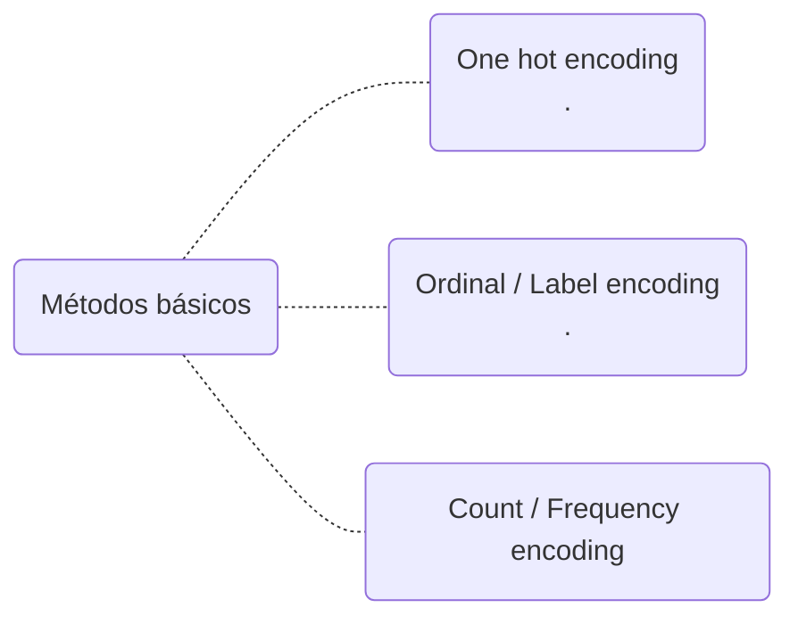

---

**Weight of Evidence**

>[!quote] **Link:** [Udemy - 1 - Weight of Evidence](https://www.udemy.com/course/feature-engineering-for-machine-learning/learn/lecture/8890280#overview)


**Mean Target**

>[!quote] **Link:** [Udemy - 1 - Mean Target](https://www.udemy.com/course/feature-engineering-for-machine-learning/learn/lecture/8886682#overview)


**CatBoost**

>[!quote] **Link:** [Article - 1 - CatBoost](https://www.geeksforgeeks.org/machine-learning/catboosts-categorical-encoding-one-hot-vs-target-encoding/)

>[!quote] **Link:** [Article - 2 - CatBoost](https://medium.com/@jraposoneto60/catboost-encoder-uma-alternativa-interessante-aos-m%C3%A9todos-tradicionais-de-encoding-831bd1a9da8)

>[!quote] **Link:** [YouTube - 1 - CatBoost](https://www.youtube.com/watch?v=KXOTSkPL2X4)


---

https://medium.com/datarisk-io/como-melhor-tratar-vari%C3%A1veis-categ%C3%B3ricas-para-modelos-de-machine-learning-parte-1-a0e3a946bb1e
Artigo web

https://miro.medium.com/v2/resize:fit:750/format:webp/1*3ugDoQOo0zdN6FF_n-NwmA.png
Imagem

Codificação por cordenadas polares que se utilizam do seno para resolver o problema do dia da semana

---


---

```ad-done
title:

#### **Fase 1 ) - One Hot Encoding**

```

---

````ad-quote
title:

```ad-quote
title:
###### A ) *Vantagens*
```

```bash
A ) Não faz presunções sobre as variáveis categóricas
# O método evita a criação de falsas hierarquias e garante um peso matemático igual para todas as opções.


B ) Mantém toda a informação da variável categórica
# A conversão para números preserva a identidade e os detalhes dos dados originais de forma integral.


C ) Funciona em modelos lineares
# A técnica estrutura os dados no formato numérico exato e independente exigido pelas equações matemáticas desses algoritmos.
```
````

````ad-quote
title:

```ad-quote
title:
###### B ) *Limitações*
```

```bash
A ) Expande o espaço de características
# A criação de colunas individuais para cada categoria aumenta drasticamente o tamanho do banco de dados e exige maior poder de processamento computacional.


B ) Não adiciona informações extras durante a encodificação
# O processo altera apenas o formato estrutural dos dados e não descobre novos padrões analíticos para o modelo.


C ) Muitas variáveis dummy podem ser idênticas e introduzir informações redundantes
# Categorias raras geram colunas repetitivas compostas quase inteiramente por zeros e causam sobrecarga inútil de processamento.
```
````

> [!done] **_New_**

```ad-quote
title:

##### 2.1 ) - _A armadilha das variáveis_
```

````ad-quote
title:

```ad-quote
title:
###### A ) *O que é*
```

```ad-quote
title:
<p align="justify">A colinearidade acontece quando duas ou mais colunas apresentam informações sobrepostas. O uso de todas as colunas cria redundância nos dados. O valor de uma coluna pode ser calculado por meio de operações matemáticas simples com as outras colunas disponíveis.</p>
```

```ad-quote
title:
<p align="justify">Algoritmos tradicionais precisam de variáveis independentes. O excesso de informações repetidas causa erros de cálculo nesses modelos. A remoção de uma das colunas resolve a redundância e permite o funcionamento correto da análise estatística.</p>
```

````

> [!done] **_New_**

```ad-quote
title:

##### 2.1 ) - _Encodificação por $k - 1$_
```

````ad-quote
title:

```ad-quote
title:
###### A ) *O que é*
```

```ad-quote
title:
<p align="justify">Essa abordagem descarta uma das colunas geradas no processo anterior. A quantidade de colunas é o total de categorias menos um. A categoria removida funciona como uma referência oculta. O sistema identifica essa categoria por dedução lógica quando as colunas restantes marcam o dígito zero.</p>
```

```ad-quote
title:
|**Cor Original**|**Coluna Vermelho**|**Coluna Verde**|
|---|---|---|
|Vermelho|1|0|
|Verde|0|1|
|Azul|0|0|
```

````

````ad-quote
title:

```ad-quote
title:
###### B ) *Melhor caso de uso*
```

```ad-quote
title:
<p align="justify">Indicado para modelos estatísticos clássicos e algoritmos lineares. Isso inclui ferramentas como a regressão linear e a regressão logística. O método previne erros nos cálculos ao garantir que cada coluna entregue uma informação única.</p>
```
````

> [!done] **_New_**

```ad-quote
title:

##### 2.1 ) - _Encodificação por $k$_
```

````ad-quote
title:

```ad-quote
title:
###### A ) *O que é*
```

```ad-quote
title:
<p align="justify">O método cria uma coluna para cada categoria de uma variável. A letra k representa o número total de categorias. Uma variável com três categorias resulta em três colunas independentes. O sistema marca o número um na coluna da categoria correta e preenche as outras com o número zero.</p>
```

```ad-quote
title:
|**Cor Original**|**Coluna Vermelho**|**Coluna Verde**|**Coluna Azul**|
|---|---|---|---|
|Vermelho|1|0|0|
|Verde|0|1|0|
|Azul|0|0|1|
```

````

````ad-quote
title:

```ad-quote
title:
###### B ) *Melhor caso de uso*
```

```ad-quote
title:
<p align="justify">Recomendado para algoritmos baseados em árvores de decisão. Esses modelos lidam bem com a redundância e não sofrem instabilidade matemática com o excesso de colunas.</p>
```
````

> [!done] **_New_**
