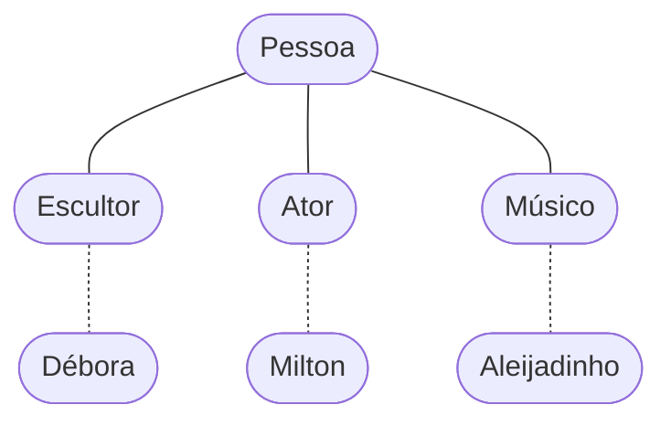
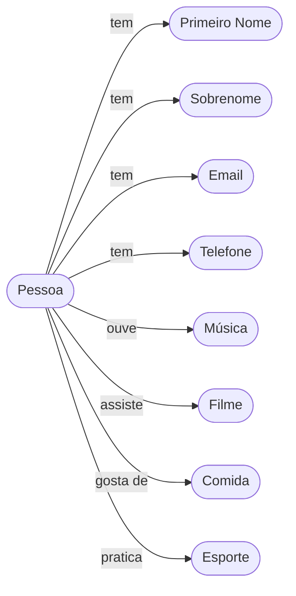
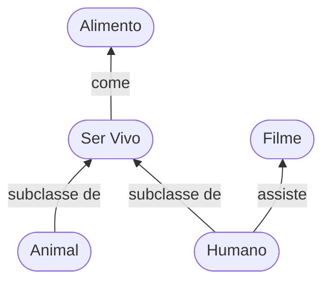
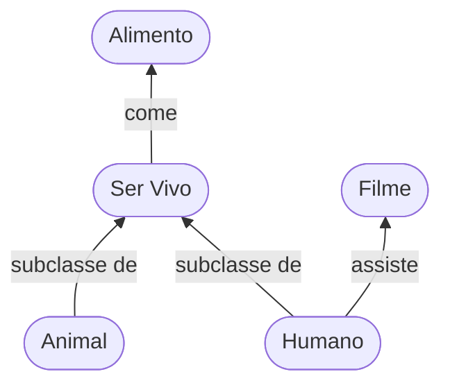
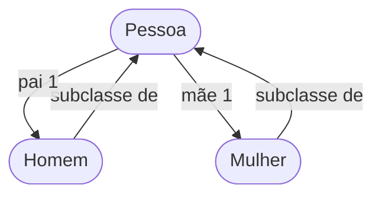
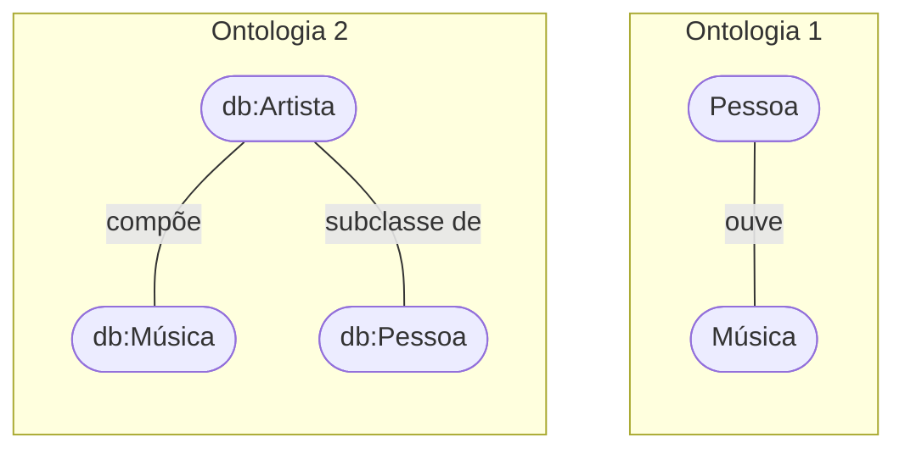
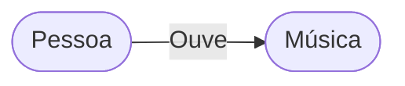

---

Dado
- É o registro do atributo de um ente, objeto ou fenômeno.

Informação 
- É a resultante do processamento, manipulação ou organização dos dados.

Conhecimento
- É uma informação nova recebida pelo receptor.

Ontologia
- É uma representação formal, explícita e compartilhada de conceitos, classes, propriedades e relações de um domínio de conhecimento. Na Web Semântica, funciona como o vocabulário lógico que atribui sentido aos dados (usando padrões como OWL e RDF), permitindo a interoperabilidade entre sistemas e o raciocínio automatizado (inferência) por agentes de software.

---



Os conceitos de uma ontologia diferem-se entre Classes e instâncias. Além disso, o relacionamento entre as Classes formam os meta-dados que explicam as instâncias.

---

#### Tipos de relacionamentos

**_is-a_**: Aleijadinho **é um** escultor.

**_part-of_**: Aleijadinho **fez parte do** movimento Barroco.

**_attribute-of_**: O nome de nascimento de Aleijadinho era Antônio Francisco Lisboa.

**_has-a_**: Aleijadinho **tem** _os Doze Profetas_ como uma de suas obras.

**Funcional**: Aleijadinho **nasceu** no hoje estado de Minas Gerais.

---

| **Sujeito** | **Predicado** | **Objeto**    |
| ----------- | ------------- | ------------- |
| Pessoa      | tem           | Primeiro Nome |
| Pessoa      | tem           | Sobrenome     |
| Pessoa      | tem           | Email         |
| Pessoa      | tem           | Telefone      |
| Pessoa      | ouve          | Música        |
| Pessoa      | assiste       | Filme         |
| Pessoa      | gosta de      | Comida        |
| Pessoa      | pratica       | Esporte       |




---

#### Axiomas

##### Restrição Hierárquica

As Classes filhas podem herdar os relacionamentos da Classe pai. Entretanto, uma Classe não pode receber os relacionamentos dos seus irmãos. 



Com base na estrutura de classes, Bob pertence à classe Animal e _Duna_ à classe Filme. Como a relação "assiste" é exclusiva da classe Humano, Bob não atende aos requisitos de tipo para assistir à obra. Portanto, esse relacionamento é inválido.

| **Sujeito**     | **Predicado**       | **Objeto**       |
| --------------- | ------------------- | ---------------- |
| Bob             | é um                | Animal           |
| Duna            | é um                | Filme            |
| **==🔴~~_Bob_~~==** | **==🔴~~_assiste_~~==** | **==🔴~~_Duna_~~==** |

##### Restrição por Relacionamento

A restrição por relacionamento define quais classes de **sujeitos** podem executar uma ação e quais classes de **objetos** podem recebê-la para que uma instância seja válida.



Dessa forma, como Bob é da classe Animal e existe a relação "come" entre Animal e Alimento, Bob pode comer Feijão. Em contrapartida, a relação "assiste" restringe-se à classe Humano; logo, enquanto Maria pode assistir a _Transformers_ por ser humana, Bob não pode fazê-lo por ser um animal.

| **Sujeito**         | **Predicado**       | **Objeto**              |
| :------------------ | :------------------ | :---------------------- |
| Transformer         | é um                | Filme                   |
| Maria               | é um                | Humano                  |
| Bob                 | é um                | Animal                  |
| Feijão              | é um                | Alimento                |
| **==🟢_Maria_==**   | **==🟢_assiste_==** | **==🟢_Transformer_==** |
| **==🟢_Bob_==**     | **==🟢_come_==**    | **==🟢_Feijão_==**      |
| **==🔴~~_Maria_~~==**   | **==🔴~~_assiste_~~==** | **==🔴~~_Feijão_~~==**  |
| **==🔴~~_Bob_~~==** | **==🔴~~_assiste_~~==** | **==🔴~~_Transformer_~~==** |
##### Restrição por Cardinalidade

A **restrição de cardinalidade** estabelece o número mínimo e máximo de conexões permitidas para um determinado relacionamento. A sua violação ocorre quando uma instância excede o limite estipulado pela modelagem.



Neste cenário, João, André e Arnaldo pertencem à classe Pessoa. Como cada pessoa pode ter exatamente um pai biológico (cardinalidade máxima = 1), a atribuição de André e, em seguida, de Arnaldo como pais de João excede o limite permitido, tornando as triplas semanticamente inválidas.

| **Sujeito**          | **Predicado**       | **Objeto**              |
| :------------------- | :------------------ | :---------------------- |
| André                | é um                | Homem                   |
| Arnaldo              | é um                | Homem                   |
| João                 | é um                | Homem                   |
| Maria                | é uma               | Mulher                  |
| **==🟢_João_==**     | **==🟢_mãe_==**     | **==🟢_Mari_==**        |
| **==🔴~~_João_~~==** | **==🔴~~_pai_~~==** | **==🔴~~_André_~~==**   |
| **==🔴~~_João_~~==** | **==🔴~~_pai_~~==** | **==🔴~~_Arnaldo_~~==** |

##### Simetria de Relacionamentos

##### Transitividade de Relacionamentos

##### Inversão de Relacionamentos

##### Restrição de Equivalências

A Equivalência de ontologias é a relação lógica estabelecida entre duas ontologias distintas que representam o mesmo domínio ou parte dele com o mesmo significado semântico.



| **Conceito (Ontologia 1)** | **Relação** | **Conceito (Ontologia 2)** |
| -------------------------- | ----------- | -------------------------- |
| Pessoa                     | equivale a  | db:Pessoa                  |
| Música                     | equivale a  | db:Música                  |

Como as classes Pessoa e Música possuem equivalência semântica entre as duas ontologias, é possível alinhar seus grafos e realizar inferências cruzadas com dados de origens distintas. Assim, unindo o fato de que Júlia ouve _Drão_ (Ontologia 1) ao registro de que Gilberto Gil compôs _Drão_ (Ontologia 2), o sistema infere que Júlia ouve uma obra composta por Gilberto Gil.

| **Sujeito**          | **Predicado** | **Objeto**        |
| :------------------- | :------------ | :---------------- |
| Júlia                | é uma         | Pessoa            |
| ==🟢_Júlia_==        | ==🟢_é uma_== | ==🟢_db:Pessoa_== |
| Drão                 | é uma         | Música            |
| ==🟢_Drão_==         | ==🟢_é uma_== | ==🟢_db:Música_== |
| Gilberto Gil         | é um          | db:Artista        |
| ==🟢_Gilberto Gil_== | ==🟢_é uma_== | ==🟢_Pessoa_==    |
| Gilberto Gil         | compõe        | Drão              |
| Júlia                | ouve          | Drão              |

##### Restrição de Disjunção

----

| **Descrição**        |
| :------------------- |
| Determinar Escopo    |
| Enumerar Termos      |
| Definir Classes      |
| Definir Propriedades |
| Definir Restrições   |
| Criar Instâncias     |


---

![[Pasted image 20261106100946.png]]


![[Pasted image 20261106101209.png]]

---
##### URL - Unified Resource Identifier

Assim como todos os dados na internet, cada classe, relacionamento e instância de uma ontologia passa a ter um endereço único, chamado de URI



http://www.poslin.letras.ufmg.br/lig948d#Pessoa
http://www.poslin.letras.ufmg.br/lig948d#ouve
http://www.poslin.letras.ufmg.br/lig948d#Musica

Forma simplificada

```shell

prefixo lig948d : http://www.poslin.letras.ufmg.br/lig948d#

lig948d:Pessoa
lig948d:ouve
lig948d:Musica

```

```embed
title: "Aula 3.2: URIs e Prefixos | Introdução a Ontologias e à Web Semântica"
image: "https://i.ytimg.com/vi/Ua39sJH8wkk/maxresdefault.jpg"
description: "Aula 3.2 do curso de \"Introdução a Ontologias e à Web Semântica\" (LIG948D), ministrado na Faculdade de Letras da Universidade Federal de Minas Gerais (FALE-U..."
url: "https://www.youtube.com/watch?v=Ua39sJH8wkk&list=PLLrlHSmC0Mw6lEj060psXrt3BSATBFVzV&index=11"
favicon: ""
aspectRatio: "56.25"
```

---
##### RDF - Resource Descriptions Framework 

É uma modelo para troca de dados na internet. Esse framework funciona como uma tabela de três colunas que representam um sujeito, predicado e objeto.

```shell

prefixo lig948d : http://www.poslin.letras.ufmg.br/lig948d#

```

| **Sujeito**    | **Predicado** | **Objeto**     |
| :------------- | :------------ | :------------- |
| lig948d:Pessoa | lig948d:Ouve  | lig948d:Música |

A RDF também pode ser utilizada para definir uma ontologia de conceitos básicos visando a criação de outra ontologia. Nesse sentido, o elementos mais importante é o "type", que define o tipo de um novo conceito a ser utilizado. 

```shell

prefixo lig948d: http://www.poslin.letras.ufmg.br/lig948d#
prefixo rdf: http://www.w3.org/1999/02/22-rdf-syntax-ns#
prefixo owl: http://www.w3.org/2002/07/owl#

```

| **Sujeito**    | **Predicado** | **Objeto**         |
| :------------- | :------------ | :----------------- |
| lig948d:Pessoa | rdf:type      | owl:Class          |
| lig948d:Ouve   | rdf:type      | owl:Class          |
| lig948d:Música | rdf:type      | owl:ObjectProperty |


```embed
title: "Aula 3.3: RDF, RDF-S e OWL | Introdução a Ontologias e à Web Semântica"
image: "https://i.ytimg.com/vi/Djqj72F-H-E/maxresdefault.jpg"
description: "Aula 3.3 do curso de \"Introdução a Ontologias e à Web Semântica\" (LIG948D), ministrado na Faculdade de Letras da Universidade Federal de Minas Gerais (FALE-U..."
url: "https://www.youtube.com/watch?v=Djqj72F-H-E&list=PLLrlHSmC0Mw6lEj060psXrt3BSATBFVzV&index=12&t=30s"
favicon: ""
aspectRatio: "56.25"
```

##### RDF-S - Resource Descriptions Framework  Schema

O RDF-S é um pacote complementar a ontologia RDF que visa disponibilizar conceitos mais descritivos e completos para a criação de outras ontologias na Web Semântica.

```shell

prefixo rdfs: http://www.w3.org/2000/01/rdf-schema#

```

| Conceito        | Descrição                                                       |
| :-------------- | :-------------------------------------------------------------- |
| rdfs:label      | Utilizado para definir o termo de um novo conceito          |
| rdfs:comment    | Utilizado para definir um comentário sobre um novo conceito |
| rdfs:subClassOf | Utilizado para definir a superclasse de um novo conceito    |
| rdfs:domain     | Utilizado para definir o domain de um novo relacionamento   |
| rdfs:range      | Utilizado para definir o range de um novo relacionamento    |
Com o RDF-S foi possível adicionar mais descrições e meta-dados a uma ontologia base. Nesse sentido, o usuário tem acesso a tradução oficial do termo, a legenda escrita pelo autor da ontologia e a declaração do Domain, Range. 

| Sujeito | Predicado | Objeto |
| :--- | :--- | :--- |
| lig948d:Pessoa | rdf:type | owl:Class |
| lig948d:Músico | rdf:type | owl:Class |
| lig948d:Músico | rdfs:label | "Musician"@en |
| lig948d:Músico | rdfs:comment | "Conceito que representa os músicos." |
| lig948d:Músico | rdfs:subClassOf | lig948d:Pessoa |
| lig948d:toca | rdf:type | owl:ObjectProperty |
| lig948d:toca | rdfs:domain | lig948d:Músico |
| lig948d:toca | rdfs:range | lig948d:Música |
##### OWL - Web Ontology Language

A OWL é a ontologia que define se um elemento deve ser uma classe, relacionamento ou instância. 

```shell

prefixo owl: http://www.w3.org/2002/07/owl#

```

| Conceito            | Descrição                                             |
| :------------------ | :---------------------------------------------------- |
| owl:Ontology        | Utilizado para definir uma ontologia              |
| owl:Class           | Utilizado para definir uma classe                 |
| owl:ObjectProperty  | Utilizado para definir relacionamentos de objetos |
| owl:DataProperty    | Utilizado para definir relacionamentos de dados   |
| owl:NamedIndividual | Utilizado para definir uma instância              |
###### Relacionamento de Objetos vs. Dados

Dentro da Web Semântica temos propriedades de objetos e de dados. 

```shell

01 ) owl:ObjectProperty
# É utilizado para relacionar duas classes


02 ) owl:DataProperty
# É utilizado para representar uma classe como um sujeito e um literal como objeto. Nesse sentido, literais são tipos primitivos de dados como números, datas, texto, etc. Representados pelo conceito rdfs:Literal

```

##### XMLSchema 

O XMLSchema é a ontologia responsável por definir os tipos primitivos de dados, também chamados de Literais na Web Semântica. 

```shell

prefixo xsd: http://www.w3.org/2001/XMLSchema#

```

| Conceito | Descrição |
| :--- | :--- |
| xsd:boolean | Valores *booleanos* (e.g., Verdadeiro ou Falso) |
| xsd:int | Valores inteiros |
| xsd:float | Valores com casa decimal |
| xsd:string | Valores textuais |
| xsd:dateTime | Valores de data e hora |
| xsd:language | Idioma (e.g., en, pt-br, etc.) |
No exemplo abaixo temos que a classe lig948d:Maria tem uma lig948d:idade de 28 inteiros positivos. 

| Sujeito        | Predicado     | Objeto              |
| :------------- | :------------ | :------------------ |
| lig948d:Pessoa | rdf:type      | owl:Class           |
| lig948d:idade  | rdf:type      | owl:DataProperty    |
| lig948d:idade  | rdfs:domain   | lig948d:Pessoa      |
| lig948d:idade  | rdfs:range    | rdfs:Literal        |
| lig948d:Maria  | rdf:type      | owl:NamedIndividual |
| lig948d:Maria  | rdf:type      | lig948d:Pessoa      |
| lig948d:Maria  | lig948d:idade | "28"^^xsd:int       |

#### Representações das Restrições em RDF-s e OWL

```shell

prefixo rdfs: http://www.w3.org/2000/01/rdf-schema#
prefixo owl: http://www.w3.org/2002/07/owl#

```

| Restrição | Conceitos |
| :--- | :--- |
| Hierárquica | rdfs:subClassOf |
| Por Relacionamento | rdfs:domain, rdfs:range |
| Por Cardinalidade | owl:cardinality, owl:maxCardinality, owl:minCardinality |
| Simetria | owl:SymmetricProperty |
| Transitividade | owl:TransitiveProperty |
| Inversão | owl:inverseOf |
| Equivalência | owl:equivalentClass, owl:equivalentProperty, owl:sameAs |
| Disjunção | owl:disjointWith, owl:propertyDisjointWith |

#### Formatos de arquivos

_Crie uma ontologia em mermaid e faça um exemplo para cada um dos tipos de arquivo abaixo. Para cada tipo faça: o que é esse arquivo, código, vantagens e desvantagens_

RDF/XML

RDFa

N-Triples

JSON-LD

Turtle

---

```embed
title: "Aula 4.2: Protégé - Instalação e Funcionalidades Básicas | Introdução a Ontologias e à Web Semântica"
image: "https://i.ytimg.com/vi/27yq30q-g1o/maxresdefault.jpg"
description: "Aula 4.2 do curso de \"Introdução a Ontologias e à Web Semântica\" (LIG948D), ministrado na Faculdade de Letras da Universidade Federal de Minas Gerais (FALE-U..."
url: "https://www.youtube.com/watch?v=27yq30q-g1o&list=PLLrlHSmC0Mw6lEj060psXrt3BSATBFVzV&index=15"
favicon: ""
aspectRatio: "56.25"
```

---

```embed
title: "www.youtube.com"
image: "https://i.ytimg.com/vi/XLV416Gjl4g/hqdefault.jpg?sqp=-oaymwEnCPYBEIoBSFryq4qpAxkIARUAAIhCGAHYAQHiAQoIGBACGAY4AUAB&rs=AOn4CLCqkYLOoJsq23y1GECF5w-Tzo7bKA"
description: ""
url: "https://www.youtube.com/playlist?list=PLLrlHSmC0Mw6lEj060psXrt3BSATBFVzV"
favicon: ""
aspectRatio: "56.09756097560976"
```

```embed
title: "www.precog.com.br"
image: ""
description: ""
url: "https://www.precog.com.br/bc-texto/obras/2021pack0652.pdf"
favicon: ""
```


