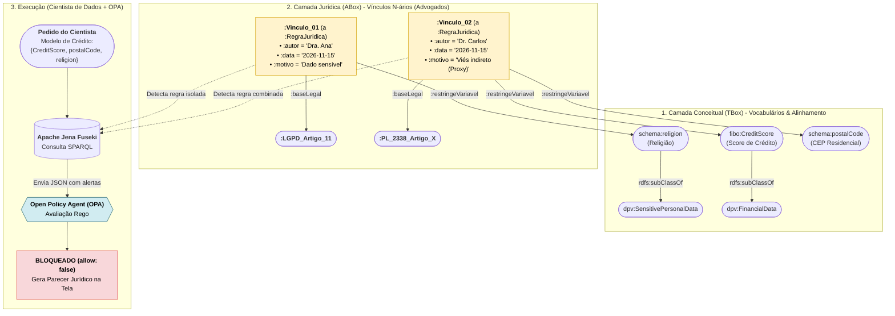

---

---

Variável
Origem Sugerida
Justificativa Legal
ossíveis Viéses / Riscos Éticos
Demanda de Governança (Estabilidade/Explicabilidade)
Explicabilidade Necessária
Implicações Legais para os possíveis viéses
Atuação como proxie

---

---
Um repositório centralizado que reunirá variáveis de crédito estruturadas sob uma ontologia comum, integrando suas métricas estatísticas e bases legais, com o diferencial de ranqueá-las com base em sua importância preditiva em múltiplos conjuntos de dados.

**FIBO Ontology Tools**
https://spec.edmcouncil.org/fibo/page/ontology-tools
https://spec.edmcouncil.org/fibo/ontology?search=income&page=1
https://github.com/edmcouncil/fibo

- A FIBO é uma ontologia desenvolvida pelo EDM Council para o mercado financeiro. Ela descreve o significado conceitual e os vínculos jurídicos de contratos e operações de crédito. A estrutura utiliza especificações da Web Semântica como OWL e RDF para registrar regras lógicas. As instituições utilizam essa base de conhecimento para integrar silos de dados divergentes. A ontologia apoia a arquitetura conceitual de novos sistemas e a conformidade regulatória.

**ISO 20022**
https://www.iso20022.org/

- A ISO 20022 é um padrão internacional para intercâmbio eletrônico de mensagens financeiras. O padrão define a sintaxe formal para transmissão de transações entre instituições bancárias. Os sistemas utilizam esquemas XML e JSON para movimentar dados operacionais com segurança. A tecnologia estabelece dicionários técnicos para mensagens de pagamentos e liquidações financeiras. Ela garante a comunicação uniforme e direta entre sistemas emissores e receptores.

---

##### Bancos de dados grafos gratuitos 
