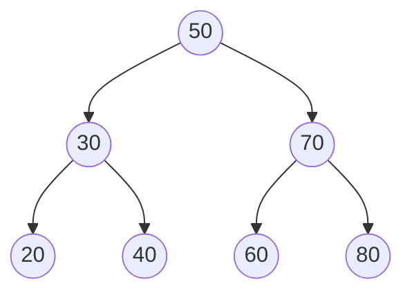
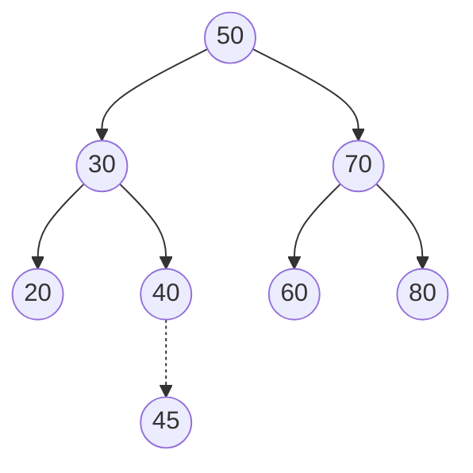
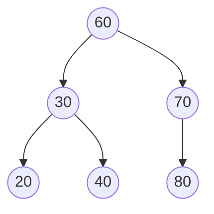

---

>[!quote] **Link:** [Árvore Binária de Busca - BST (YouTube)](https://youtu.be/bBbnph5PnH8)

---

```ad-done
title:
#### **Fase 1 ) - Fundamentos e Propriedades**
```

---

````ad-quote
title:

##### **01 )** - Árvore Binária de Busca (BST)

```ad-quote
title:
<p align="justify">Uma Árvore Binária de Busca (Binary Search Tree - BST) é uma estrutura de dados hierárquica e dinâmica baseada em nós ligados por ponteiros. O diferencial crucial da BST em relação a uma árvore binária convencional é a sua regra rígida de ordenação das chaves em cada nó, garantindo que operações de busca, inserção e remoção possam ser executadas com alta eficiência proporcional à altura da árvore.</p>
```
````

> [!done] **_New_**

```ad-quote
title:

##### 1.1 ) - _Propriedades Estruturais_
```

````ad-quote
title:

```ad-quote
title:
###### A ) *Invariante de Ordenação*
```

```ad-quote
title:
<p align="justify">A regra que governa toda árvore binária de busca estabelece que a chave de qualquer nó serve como divisor ordenado entre seus dois ramos descendentes.</p>
```

```bash
01 ) Subárvore Esquerda
# Para todo nó x, qualquer chave pertencente à subárvore esquerda de x é estritamente MENOR que a chave de x: chave(esq) < chave(x).


02 ) Subárvore Direita
# Para todo nó x, qualquer chave pertencente à subárvore direita de x é estritamente MAIOR que a chave de x: chave(dir) > chave(x).


03 ) Recursividade Estrutural
# Ambas as subárvores esquerda e direita também devem ser, individualmente, árvores binárias de busca válidas.


04 ) Política de Duplicatas
# Árvores de busca canônicas não admitem chaves duplicadas. Caso valores repetidos sejam permitidos, adota-se uma convenção rígida (como desviar sempre para a subárvore direita). Nesta implementação, chaves duplicadas são ignoradas.
```
````

````ad-quote
title:

```ad-quote
title:
###### B ) *Métricas e Complexidade Geral*
```

```bash
01 ) Altura da Árvore (h)
# O custo de todas as operações primitivas (busca, inserção, remoção) é diretamente proporcional à altura h da árvore: O(h).


02 ) Caso Balanceado
# Quando as ramificações estão bem distribuídas, a altura é mínima: h = floor(log2(n)), resultando em complexidade O(log n).


03 ) Pior Caso (Degeneração)
# Quando os elementos são inseridos em ordem crescente ou decrescente, a árvore degenera em uma lista linear: h = n, resultando em complexidade O(n).
```
````

> [!done] **_New_**

```ad-quote
title:

##### 1.2 ) - _Representação do Nó em C_
```

````ad-quote
title:

```ad-quote
title:
###### A ) *Definição da Estrutura*
```

```ad-quote
title:
<p align="justify">Cada elemento na memória é representado por uma célula contendo a chave utilizada para ordenação e busca, o dado satélite (conteúdo) e dois ponteiros de autorreferência para os nós descendentes.</p>
```

```C
struct cel {
    int chave;          // Chave de busca (critério de ordenação);
    int conteudo;       // Conteúdo/elemento satélite armazenado;
    struct cel *esq;    // Ponteiro para a sub-árvore esquerda;
    struct cel *dir;    // Ponteiro para a sub-árvore direita;
};

typedef struct cel noh;
```
````

---

```ad-done
title:
#### **Fase 2 ) - Operações Primitivas e Consulta**
```

---

````ad-quote
title:

##### **02 )** - Operações de Consulta

```ad-quote
title:
<p align="justify">As operações de consulta em uma BST exploram diretamente a invariante de ordenação para descartar metade da árvore a cada comparação em cenários equilibrados, sem necessitar de busca linear exaustiva.</p>
```
````

> [!done] **_New_**

```ad-quote
title:

##### 2.1 ) - _Busca de Chave_
```

````ad-quote
title:

```ad-quote
title:
###### A ) *Análise de Complexidade*
```

```bash
01 ) Pior Caso: O(n)
# Ocorre quando a árvore se encontra degenerada em lista linear e o elemento está na folha mais profunda ou não existe.


02 ) Caso Médio: O(log n)
# Em árvores equilibradas, cada comparação reduz o espaço de busca pela metade.


03 ) Complexidade Geral: O(h)
# Tempo limitado superiormente pelo comprimento do maior caminho da raiz até uma folha.
```
````

````ad-quote
title:

```ad-quote
title:
###### B ) *Implementação Rastreada (Recursiva)*
```

```C
noh busca_rastreada(noh r, int x) {
    if (r == NULL) {
        printf("Ponteiro nulo. Chave nao encontrada.\n");
        return NULL;
    }

    printf("Visitando: %d\n", r->chave);

    if (r->chave == x) {
        printf("Chave %d encontrada!\n", x);
        return r;
    }

    if (r->chave > x) {
        printf("%d < %d -> esquerda\n", x, r->chave);
        return busca_rastreada(r->esq, x);
    }

    printf("%d > %d -> direita\n", x, r->chave);
    return busca_rastreada(r->dir, x);
}
```
````

`````ad-quote
title:

````ad-quote
title:
###### C ) *Execução da Busca*
````

````ad-quote
title:

````
````shell
# BUSCANDO 40

Visitando: 50
40 < 50 -> esquerda
Visitando: 30
40 > 30 -> direita
Visitando: 40
Chave 40 encontrada!
````
````shell
# BUSCANDO 45

Visitando: 50
45 < 50 -> esquerda
Visitando: 30
45 > 30 -> direita
Visitando: 40
45 > 40 -> direita
Ponteiro nulo. Chave não encontrada.
````
`````

> [!done] **_New_**

```ad-quote
title:

##### 2.2 ) - _Elementos Mínimo e Máximo_
```

````ad-quote
title:

```ad-quote
title:
###### A ) *Propriedade dos Extremos*
```

```bash
01 ) Menor Elemento (Mínimo)
# O menor elemento de qualquer BST reside obrigatoriamente no nó mais à extrema esquerda. Desce-se recursivamente por r->esq até r->esq ser NULL.


02 ) Maior Elemento (Máximo)
# O maior elemento reside no nó mais à extrema direita. Desce-se recursivamente por r->dir até r->dir ser NULL.


03 ) Complexidade Temporal
# Ambas as operações percorrem a profundidade máxima de um único ramo: O(h).
```
````

````ad-quote
title:

```ad-quote
title:
###### B ) *Implementação em C*
```

```C
noh *minimo(noh *r) {
    if (r == NULL || r->esq == NULL) {
        return r;
    }
    return minimo(r->esq);
}

noh *maximo(noh *r) {
    if (r == NULL || r->dir == NULL) {
        return r;
    }
    return maximo(r->dir);
}
```
````

---

```ad-done
title:
#### **Fase 3 ) - Modificação Estrutural**
```

---

````ad-quote
title:

##### **03 )** - Inserção e Remoção

```ad-quote
title:
<p align="justify">As operações de modificação alteram dinamicamente a topologia da árvore, exigindo alocação e liberação de memória em heap e a preservação estrita da invariante da BST.</p>
```
````

> [!done] **_New_**

```ad-quote
title:

##### 3.1 ) - _Inserção de Elementos_
```

````ad-quote
title:

```ad-quote
title:
###### A ) *Dinâmica e Complexidade*
```

```bash
01 ) Trajeto Unidirecional
# A inserção percorre um único caminho da raiz até uma posição vazia (NULL), onde um novo nó folha é criado e anexado.


02 ) Complexidade Temporal
# Complexidade O(h). Em árvores balanceadas opera em O(log n); no pior caso degenerado, opera em O(n).
```
````

````ad-quote
title:

```ad-quote
title:
###### B ) *Implementação Rastreada (Recursiva)*
```

```C
noh inserir_rastreado(noh r, int chave, int conteudo) {
    if (r == NULL) {
        printf("Ponteiro nulo. Criando no %d.\n", chave);
        return criar_noh(chave, conteudo);
    }

    printf("Visitando: %d\n", r->chave);

    if (chave < r->chave) {
        printf("%d < %d -> esquerda\n", chave, r->chave);
        r->esq = inserir_rastreado(r->esq, chave, conteudo);
    } else if (chave > r->chave) {
        printf("%d > %d -> direita\n", chave, r->chave);
        r->dir = inserir_rastreado(r->dir, chave, conteudo);
    } else {
        printf("Chave %d ja existe!\n", chave);
    }

    return r;
}
```
````

`````ad-quote
title:

````ad-quote
title:
###### C ) *Execução da Inserção*
````

````ad-quote
title:

````
````shell
# INSERINDO 45

Visitando: 50
45 < 50 -> esquerda
Visitando: 30
45 > 30 -> direita
Visitando: 40
45 > 40 -> direita
Ponteiro nulo. Criando no 45.
````
````shell
# INSERINDO 30

Visitando: 50
30 < 50 -> esquerda
Visitando: 30
Chave 30 ja existe!
````
`````

> [!done] **_New_**

```ad-quote
title:

##### 3.2 ) - _Remoção de Elementos_
```

````ad-quote
title:

```ad-quote
title:
###### A ) *Casos de Remoção*
```

```bash
01 ) Caso 1: Chave Inexistente
# Atinge-se um ponteiro NULL sem localizar a chave. Nenhuma modificação é feita na estrutura.


02 ) Caso 2: Nó com 0 ou 1 Filho
# - Nó Folha (0 filhos): Libera a memória alocada para o nó e retorna NULL ao pai.
# - 1 Filho: O nó pai assume diretamente o neto existente (esquerdo ou direito), liberando a memória do nó excluído.


03 ) Caso 3: Nó com 2 Filhos
# Busca-se o SUCESSOR EM-ORDEM: menor chave da subárvore direita (minimo(r->dir)).
# (Ou o ANTECESSOR EM-ORDEM: maior chave da subárvore esquerda, maximo(r->esq)).
# Copiam-se a chave e os dados do sucessor para o nó atual.
# Remove-se recursivamente o nó sucessor duplicado na subárvore direita.
```
````

````ad-quote
title:

```ad-quote
title:
###### B ) *Análise de Complexidade*
```

```bash
# Complexidade temporal: O(h).
# Requer uma busca até o elemento O(h) e, no caso de 2 filhos, uma descida auxiliar até o sucessor O(h).
```
````

````ad-quote
title:

```ad-quote
title:
###### C ) *Implementação Rastreada (Recursiva)*
```

```C
noh remover_rastreado(noh r, int chave) {
    if (r == NULL) {
        printf("Ponteiro nulo. Chave %d nao encontrada.\n", chave);
        return NULL;
    }

    printf("Visitando: %d\n", r->chave);

    if (chave < r->chave) {
        printf("%d < %d -> esquerda\n", chave, r->chave);
        r->esq = remover_rastreado(r->esq, chave);
    } else if (chave > r->chave) {
        printf("%d > %d -> direita\n", chave, r->chave);
        r->dir = remover_rastreado(r->dir, chave);
    } else {
        printf("Chave %d localizada!\n", chave);

        if (r->esq == NULL) {
            printf("Substituindo por filho direito.\n");
            noh *temp = r->dir;
            free(r);
            return temp;
        } else if (r->dir == NULL) {
            printf("Substituindo por filho esquerdo.\n");
            noh *temp = r->esq;
            free(r);
            return temp;
        }

        printf("Dois filhos. Buscando sucessor...\n");
        noh *temp = minimo(r->dir);
        printf("Sucessor: %d\n", temp->chave);
        r->chave = temp->chave;
        r->conteudo = temp->conteudo;

        printf("Removendo sucessor %d...\n", temp->chave);
        r->dir = remover_rastreado(r->dir, temp->chave);
    }

    return r;
}
```
````

`````ad-quote
title:

````ad-quote
title:
###### D ) *Execução da Remoção (Caso com Dois Filhos)*
````

````ad-quote
title:

````

````ad-quote
title:

````
````shell
# REMOVENDO 50 (CASO 3: NO COM DOIS FILHOS)

Visitando: 50
Chave 50 localizada!
Dois filhos. Buscando sucessor...
Sucessor: 60
Removendo sucessor 60...
Visitando: 70
60 < 70 -> esquerda
Visitando: 60
Chave 60 localizada!
Substituindo por filho direito.
````
`````

---

```ad-done
title:
#### **Fase 4 ) - Travessia e Ordenação**
```

---

````ad-quote
title:

##### **04 )** - Percurso Em-Ordem (In-Order)

```ad-quote
title:
<p align="justify">O percurso em-ordem (visitação simétrica) percorre a estrutura na sequência estrita: Subárvore Esquerda -> Raiz -> Subárvore Direita. Em uma Árvore Binária de Busca, este percurso possui a notável propriedade matemática de visitar todas as chaves em ordem ESTRITAMENTE CRESCENTE.</p>
```
````

> [!done] **_New_**

```ad-quote
title:

##### 4.1 ) - _Algoritmo e Complexidade_
```

````ad-quote
title:

```ad-quote
title:
###### A ) *Métricas de Desempenho*
```

```bash
01 ) Complexidade Temporal: O(n)
# Cada um dos n nós da árvore é visitado e impresso exatamente uma vez.


02 ) Complexidade Espacial Auxiliar: O(h)
# Determinada pela profundidade máxima da pilha de chamadas da recursão (h = log n no caso equilibrado).
```
````

````ad-quote
title:

```ad-quote
title:
###### B ) *Implementação em C*
```

```C
void imprimir_em_ordem(noh *r) {
    if (r != NULL) {
        imprimir_em_ordem(r->esq);
        printf("[%d: %d] ", r->chave, r->conteudo);
        imprimir_em_ordem(r->dir);
    }
}
```
````

---

```ad-done
title:
#### **Fase 5 ) - Degeneração e Balanceamento**
```

---

````ad-quote
title:

##### **05 )** - Desbalanceamento Estrutural

```ad-quote
title:
<p align="justify">A maior limitação da BST clássica é a sua dependência direta da ordem de inserção dos elementos. Sequências pré-ordenadas degradam totalmente a árvore para uma estrutura linear, anulando os benefícios de busca hierárquica.</p>
```
````

> [!done] **_New_**

```ad-quote
title:

##### 5.1 ) - _Degeneração e Soluções_
```

````ad-quote
title:

```ad-quote
title:
###### A ) *Degeneração em Lista Linear*
```

```bash
01 ) Cenário Crítico
# Inserção de chaves ordenadas de forma estritamente crescente (ex: 10, 20, 30, 40, 50) ou decrescente.


02 ) Deformação Topológica
# Cada nó inserido terá apenas um descendente (sempre à direita ou sempre à esquerda), assemelhando a estrutura a uma lista encadeada simples.


03 ) Degradação Assintótica
# A altura atinge h = n. As operações de busca, inserção e remoção perdem a eficiência O(log n) e degradam para O(n).
```
````

````ad-quote
title:

```ad-quote
title:
###### B ) *Modelos Auto-balanceados*
```

```ad-quote
title:
| Tipo de Árvore | Mecanismo de Balanceamento | Fator de Equilíbrio |
| :--- | :--- | :--- |
| **Árvore AVL** | Rotações simples e duplas baseadas no Fator de Balanceamento (`fb = alt_esq - alt_dir`). | Rígido: `\|fb\| <= 1` em todos os nós. Máxima eficiência para cenários de muitas consultas. |
| **Árvore Rubro-Negra** | Regras de coloração de nós (vermelho/preto) combinadas com rotações estruturais. | Flexível: Altura máxima `<= 2 log(n + 1)`. Excelente performance para frequentes inserções e remoções. |
```
````

---
