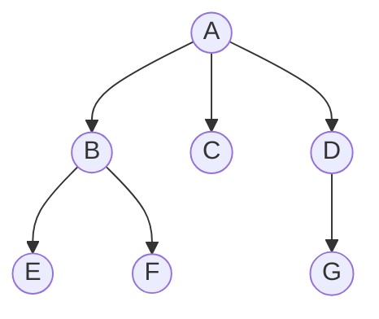
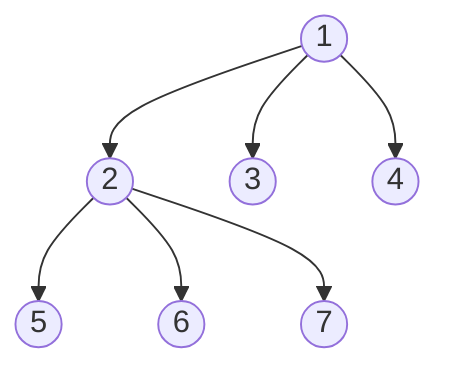
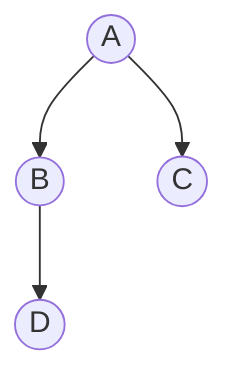
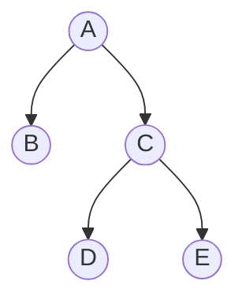
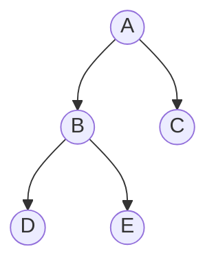
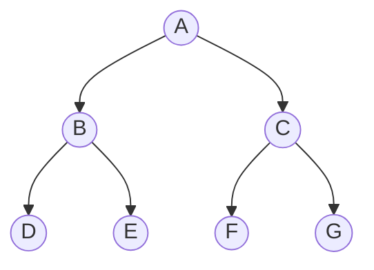
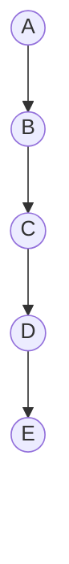
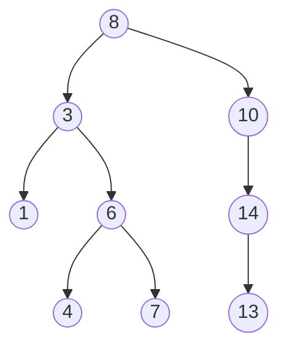

---

```ad-done
title:
#### **Fase 1 ) - Fundamentos e Nomenclatura**
```

---

````ad-quote
title:

##### **01 )** - Estrutura de Árvores

```ad-quote
title:
<p align="justify">Árvores são estruturas de dados hierárquicas e não-lineares compostas por um conjunto de nós interligados por arestas direcionadas (ou arcos). Diferente de vetores e listas ligadas, os elementos não estão organizados de maneira sequencial contínua, mas sim em níveis de dependência e derivação a partir de um elemento de origem (raiz).</p>
```
````

> [!done] **_New_**

```ad-quote
title:

##### 1.1 ) - _Métricas com Foco Duplo_
```

````ad-quote
title:

```ad-quote
title:
###### A ) *Grau, Altura e Nível*
```

![[Pasted image 20260921214234.png]]

```bash
01 ) Grau de um nó
# Número de filhos conectados a um elemento específico.


02 ) Grau de uma árvore
# Valor do maior grau encontrado considerando todos os nós da estrutura.


03 ) Altura de um nó
# Tamanho do maior caminho entre o elemento e as folhas acrescido de um.


04 ) Altura de uma árvore
# Medida que corresponde à altura do próprio nó raiz.


05 ) Nível de um nó
# Quantidade de arcos no trajeto que vai da raiz até o elemento.


06 ) Nível de uma árvore
# Representa o valor máximo de nível alcançado por qualquer nó dentro da estrutura inteira.
```

````

> [!done] **_New_**

```ad-quote
title:

##### 1.2 ) - _Navegação e Trajetos_
```

````ad-quote
title:

```ad-quote
title:
###### A ) *Métricas de Caminho*
```

```bash
01 ) Caminho
# Sequência única de arcos que conduz a um nó específico a partir da raiz da árvore.


02 ) Comprimento do caminho
# Número total de arcos presentes no trajeto percorrido.
```

````

> [!done] **_New_**

```ad-quote
title:

##### 1.3 ) - _Tipologia de Elementos e Relacionamentos_
```

````ad-quote
title:

```ad-quote
title:
###### A ) *Classificação dos Nós*
```

```bash
01 ) Raiz
# Nó principal que atua como o ponto de partida e origem de toda a estrutura hierárquica.


02 ) Nó interno
# Qualquer elemento intermediário da árvore que possui ramificações para filhos.


03 ) Folha (Nó externo)
# Elemento de grau zero localizado na terminação da árvore, que não possui descendentes.
```

````

````ad-quote
title:

```ad-quote
title:
###### B ) *Relações de Parentesco e Escopo*
```

```bash
01 ) Pai
# Nó classificado como ancestral direto que se liga aos elementos da camada imediatamente inferior.


02 ) Filho
# Nó classificado como descendente direto originado a partir de um nó pai.


03 ) Irmãos
# Nós que compartilham exatamente o mesmo nó pai na estrutura.


04 ) Ancestrais e descendentes
# Termos que representam a linhagem completa situada acima ou abaixo de um ponto de referência.


05 ) Subárvore
# Divisão menor da estrutura original constituída por um nó e todos os seus descendentes, operando como uma árvore independente.


06 ) Ordem
# Limite máximo de filhos que um elemento pode ter em um modelo estrutural determinado.
```

````

---

```ad-done
title:
#### **Fase 2 ) - Tipologia e Classificação de Árvores**
```

---

````ad-quote
title:

##### **02 )** - Modelos Estruturais

```ad-quote
title:
<p align="justify">As árvores podem ser classificadas de acordo com as restrições impostas à sua ramificação máxima (grau de saída) e ao balanceamento da sua distribuição espacial.</p>
```
````

> [!done] **_New_**

```ad-quote
title:

##### 2.1 ) - _Árvores Genéricas e de Ordem Fixa_
```

`````ad-quote
title:

```ad-quote
title:
###### A ) *Árvores Genéricas*
```

```ad-quote
title:
<p align="justify">Nesse formato não existe um limite fixo para o grau de cada nó. A quantidade de filhos pode variar livremente de um elemento para outro, crescendo sem regras preestabelecidas de ordenação de dados.</p>
```

````ad-quote
title:

````
`````

`````ad-quote
title:

```ad-quote
title:
###### B ) *Árvores de Ordem Fixa*
```

```ad-quote
title:
<p align="justify">Neste modelo a estrutura adota um padrão numérico rígido: todos os nós possuem a mesma ordem máxima predeterminada (no exemplo abaixo, o limite máximo de filhos por nó é três).</p>
```

````ad-quote
title:

````
`````

> [!done] **_New_**

```ad-quote
title:

##### 2.2 ) - _A Família das Árvores Binárias_
```

`````ad-quote
title:

```ad-quote
title:
###### A ) *Árvore Binária Padrão*
```

```ad-quote
title:
<p align="justify">Organização em que cada nó possui no máximo dois filhos, formalmente particionados em uma subárvore esquerda e uma subárvore direita.</p>
```

````ad-quote
title:

````
`````

`````ad-quote
title:

```ad-quote
title:
###### B ) *Árvore Estritamente Binária*
```

```ad-quote
title:
<p align="justify">Variação onde todos os nós possuem estritamente grau zero ou grau dois: cada elemento não tem nenhum filho ou possui obrigatoriamente dois filhos conectados.</p>
```

````ad-quote
title:

````
`````

`````ad-quote
title:

```ad-quote
title:
###### C ) *Árvore Binária Completa*
```

```ad-quote
title:
<p align="justify">Estrutura que respeita a regra estrita e assegura que qualquer nó que apresente subárvore vazia esteja localizado exclusivamente no último ou no penúltimo nível da árvore.</p>
```

````ad-quote
title:

````
`````

`````ad-quote
title:

```ad-quote
title:
###### D ) *Árvore Binária Cheia*
```

```ad-quote
title:
<p align="justify">Configuração de máxima simetria: todos os nós internos possuem exatamente dois filhos e todas as folhas terminam estritamente no mesmo nível final da estrutura.</p>
```

````ad-quote
title:

````
`````

`````ad-quote
title:

```ad-quote
title:
###### E ) *Árvore em Ziguezague (Degenerada)*
```

```ad-quote
title:
<p align="justify">Estrutura com a maior altura possível dentro dos modelos binários. Cada nó interno deixa propositalmente uma subárvore vazia, aproximando o comportamento e a busca da árvore aos de uma lista linear.</p>
```

````ad-quote
title:

````
`````

---

```ad-done
title:
#### **Fase 3 ) - Operações Primitivas e Percursos**
```

---

````ad-quote
title:

##### **03 )** - Navegação e Processamento

```ad-quote
title:
<p align="justify">Mecanismos algorítmicos para consultar componentes fundamentais e visitar sistematicamente todos os nós de uma árvore binária sem repetição.</p>
```
````

> [!done] **_New_**

```ad-quote
title:

##### 3.1 ) - _Operações Primitivas de Acesso_
```

````ad-quote
title:

```ad-quote
title:
###### A ) *Primitivas de Manipulação*
```

```bash
01 ) sae::A
# Retorna o ponteiro para a subárvore esquerda do nó A.


02 ) sad::A
# Retorna o ponteiro para a subárvore direita do nó A.


03 ) element::A
# Retorna o valor ou elemento de dados armazenado no nó A.
```

````

> [!done] **_New_**

```ad-quote
title:

##### 3.2 ) - _Algoritmos de Travessia (Percursos)_
```

`````ad-quote
title:

```ad-quote
title:
###### A ) *Árvore de Referência*
```

````ad-quote
title:

````
`````

````ad-quote
title:

```ad-quote
title:
###### B ) *Tipos de Percurso*
```

```bash
01 ) Pré-ordem (Preorder: R -> E -> D)
# 1. Visita o nó raiz da árvore.
# 2. Percorre a subárvore esquerda em pré-ordem.
# 3. Percorre a subárvore direita em pré-ordem.
# Produz a expressão em forma prefixa (notação polonesa, como na linguagem LISP).
# Resultado na árvore acima: 8, 3, 1, 6, 4, 7, 10, 14, 13


02 ) Em-ordem (Inorder: E -> R -> D)
# 1. Percorre a subárvore esquerda em em-ordem.
# 2. Visita o nó raiz central.
# 3. Percorre a subárvore direita em em-ordem.
# Produz a expressão na sua forma mais usual ou infixa (ordem simétrica).
# Resultado na árvore acima: 1, 3, 4, 6, 7, 8, 10, 13, 14


03 ) Pós-ordem (Postorder: E -> D -> R)
# 1. Percorre a subárvore esquerda em pós-ordem.
# 2. Percorre a subárvore direita em pós-ordem.
# 3. Visita o nó raiz por último.
# Produz a expressão em forma posfixa (notação polonesa reversa, calculadoras HP).
# Resultado na árvore acima: 1, 4, 7, 6, 3, 13, 14, 10, 8
```

````

---
