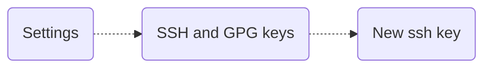

---

```ad-done
title:  

#### **Fase 01 ) - Conexão via SSH**

```

---

````ad-quote
title:
```ad-quote
title:
###### A ) - Geração da chave SSH
```

```bash
# Abrir o terminal
ctrl + alt + t

# Criar chave ssh
ssh-keygen -t ed25519 -C "andre.soares.moreira18@gmail.com"

# Chave privada secreta
~/.ssh/id_ed25519

# Chave pública para o GitHub
~/.ssh/id_ed25519.pub

# Printar chave no terminal
cat ~/.ssh/id_ed25519.pub
```
````

`````ad-quote
title:
```ad-quote
title:
###### B ) - Adição da chave - [Github](https://github.com/settings/keys)
```

````ad-quote
title:

````

```bash
# Teste de conexão
ssh -T git@github.com
```
`````

---

> [!done] **_New_**

---

````ad-quote
title:

##### **02 )** - Utilização da chave SSH

```ad-quote
title:
<p align="justify">Após realizar a conexão via SSH é necessário utilizar outro método para subir o diretório.</p>
```
````

````ad-quote
title:
```ad-quote
title:
###### A ) Adição da url
```

```bash
git remote set-url origin git@github.com:OfAndreS/YourRepo.git
```
````

````ad-quote
title:

```ad-quote
title:
###### B ) Subindo repositório 
```

```bash
# 1. Inicia o Git na pasta atual
git init

# 2. Adiciona todos os seus arquivos para o primeiro commit
git add .

# 3. Cria o primeiro "snapshot" (commit)
git commit -m "Commit inicial"

# 4. Adicione o remoto do GitHub
git remote add origin git@github.com:OfAndreS/EmotionsPatterns.git

# 5. Altera o nome da branch para main
git branch -m <novo-name>

# 6. E envie seu commit inicial
git push -u origin main
```
````

---
