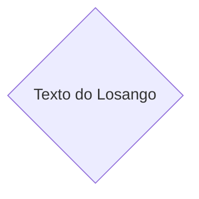
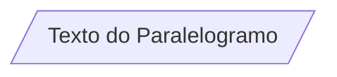
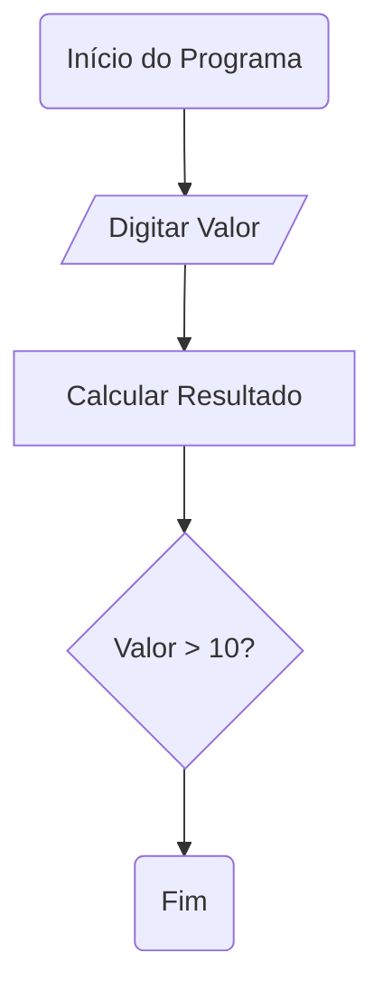

---

`````ad-quote
title: 
##### **01 ) -** Retângulo

```ad-quote
title:  

Utilizado para representar ações operacionais, etapas de processo ou atribuições genéricas de dados.
```

```txt
graph TD
    id1[Texto do Retângulo]
```

````ad-quote
title:

````

`````

>[!done] ***New***

`````ad-quote
title: 
##### **02 ) -** Retângulo com Bordas Arredondadas

```ad-quote
title:  
Utilizado rotineiramente na estrutura para marcar o ponto exato de início ou o término de um algoritmo.
```

````ad-quote
title:

````

```txt
graph TD
    id2(Texto Arredondado)
```
`````

>[!done] ***New***

`````ad-quote
title: 
##### **03 ) -** Losango

```ad-quote
title:  
Utilizado para testes lógicos, estruturas condicionais e tomadas de decisão que dividem o fluxo.
```

```
graph TD
    id3{Texto do Losango}
```

````ad-quote
title:

````
`````

>[!done] ***New***

`````ad-quote
title: 
##### **04 ) -** Paralelogramo

```ad-quote
title:  
Utilizado especificamente para indicar operações de entrada ou saída manual de dados (_input/output_).

```txt
graph TD
    id4[/Texto do Paralelogramo/]
```

````ad-quote
title:

````
`````

---

>[!done] ***New***

---

`````ad-quote
title:

##### **Ex ) -** Mermaid

````ad-quote
title:

````
`````

---