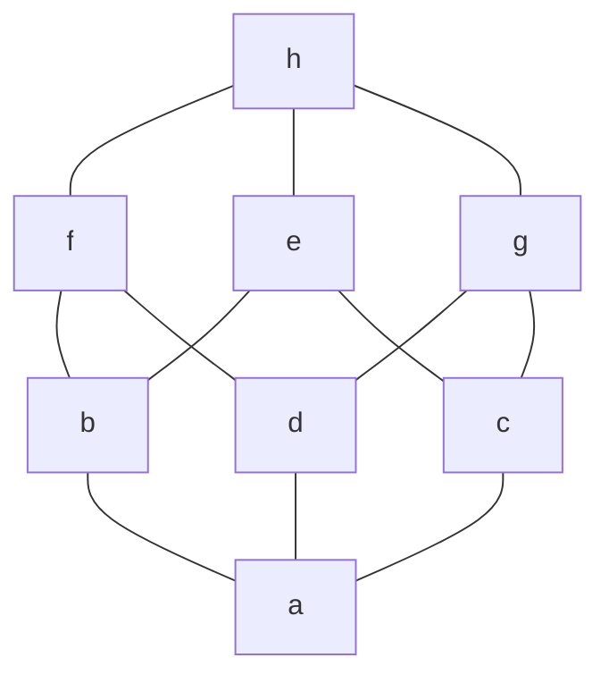

---

```ad-done
title:
#### **Fase 1 ) - Conteúdo**
```

---

`````ad-quote
title:

##### **01 ) -** Definição Formal

```ad-quote
title:
Uma álgebra booleana é um Reticulado  [[FMC II - UIII - Reticulados| { X } ]] limitado que atende obrigatoriamente a duas condições simultâneas: ele precisa ser distributivo e complementado. Isso garante que a estrutura possua um máximo global $1$ e um mínimo global $0$.
```

````ad-quote
title:

````
`````

````ad-quote
title:

##### 1.1 ) - _Sinais analíticos_
````

````ad-quote
title:

```ad-quote
title:
###### A ) *Limites Absolutos*
```

```ad-quote
title:
Para todo elemento $a\in R$, devem existir elementos únicos $0,1\in R$ na estrutura tais que a relação de ordem absoluta seja garantida:
```

```ad-quote
title:
Limite mínimo global: 

1. $$0\le a$$
   
Limite máximo global: 

2. $$a\le 1$$
```
````

````ad-quote
title:

```ad-quote
title:
###### B ) *Complementaridade*
```
```ad-quote
title:
Para todo elemento $a \in R$, deve existir um, e apenas um, elemento $b \in R$ tal que:
```
```ad-quote
title:
O supremo atinge o limite máximo global:

1. $$a \vee b = 1$$
   
O ínfimo atinge o limite mínimo global:

2. $$a \wedge b = 0$$
```
````

````ad-quote
title:

```ad-quote
title:
###### C ) *Distributividade*
```

```ad-quote
title:
Para quaisquer elementos $a,b,c\in R$, as operações do reticulado devem se distribuir mutuamente satisfazendo as seguintes igualdades:
```
```ad-quote
title:

Distribuição da junção 

1. $$a\vee(b\wedge c)=(a\vee b)\wedge(a\vee c)$$


Distribuição do encontro 

2. $$a\wedge(b\vee c)=(a\wedge b)\vee(a\wedge c)$$

```
````

````ad-quote
title:

##### 1.2 ) - _Sinais visuais_
````

`````ad-quote
title:
```ad-quote
title:
###### A ) _Contagem de elementos_
```

```ad-quote
title:
- O total de nós precisa ser uma potência exata de dois ($2^n$).
```

```ad-quote
title:
###### Contra exemplo
```

```ad-quote
title:
O diagrama possui 6 elementos. Como 6 não é uma potência exata de dois ($2^n$), a estrutura falha imediatamente. Não é necessário calcular nenhuma operação matemática para reprovar o gráfico.
```

````ad-quote
title:
```mermaid
graph BT
    1 --- 2
    1 --- 3
    2 --- 4
    2 --- 6
    3 --- 6
    4 --- 12
    6 --- 12
````
`````

`````ad-quote
title:
```ad-quote
title:
###### B ) *Formas proibidas*
```

```ad-quote
title:
- A estrutura não deve conter subgrafos no formato de pentágono ou diamante.
```

```ad-quote
title:
###### *Contra exemplo*
```

```ad-quote
title:
O diagrama contém a estrutura de um _diamante_ ($M_3$). A existência de três elementos paralelos (_a_, _b_, _c_) que se conectam de forma direta e simultânea aos mesmos limites destrói a propriedade da distributividade.
```

````ad-quote
title:
```mermaid
graph BT
    0 --- a
    0 --- b
    0 --- c
    a --- 1
    b --- 1
    c --- 1
````
`````

`````ad-quote
title:
```ad-quote
title:
###### C ) _Simetria geométrica_
```

```ad-quote
title:
- O diagrama deve apresentar espelhamento estrutural perfeito entre suas metades superior e inferior.
```

```ad-quote
title:
###### _Contra exemplo_
```

```ad-quote
title:
O diagrama possui 8 elementos e passa no teste de contagem, mas falha no espelhamento visual. A base origina apenas dois caminhos (_a_, _b_), enquanto o topo recebe quatro ramificações (_c_, _d_, _e_, _f_). Essa assimetria torna impossível a existência de complementares exclusivos.
```

````ad-quote
title:
```mermaid
graph BT
    0 --- a
    0 --- b
    a --- c
    a --- d
    b --- e
    b --- f
    c --- 1
    d --- 1
    e --- 1
    f --- 1
````
`````

---

```ad-done
title:
#### **Fase 2 ) - Propriedades**
```

---

````ad-quote
title:

##### 2.1 ) - *Propriedades da Álgebra Booleana*
````

````ad-quote
title:

```ad-quote
title: 
###### A ) *Distributividade*
```

```ad-quote
title: 
A operação de _supremo_ se distribui sobre a operação de _ínfimo_, e o inverso também ocorre de forma idêntica. Você pode espalhar um termo externo sobre os termos internos de um agrupamento sem quebrar a equação.
```

```ad-quote
title:

1. $$x \vee (y \wedge z) = (x \vee y) \wedge (x \vee z)$$
2. $$x \wedge (y \vee z) = (x \wedge y) \vee (x \wedge z)$$
```
````

````ad-quote
title:

```ad-quote
title: 
###### B ) *Complemento*
```

```ad-quote
title: 
Definição formal: Para todo elemento contido no conjunto, existe um oposto estrutural único. A interação de uma variável com o seu oposto força o resultado a atingir os limites absolutos da estrutura imediatamente.
```

```ad-quote
title:

1. $$x \vee x^{\prime} = 1$$
2. $$x \wedge x^{\prime} = 0$$
```
````

````ad-quote
title:

```ad-quote
title: 
###### C ) *Identidade*
```

```ad-quote
title: 
Definição formal: A operação direta de um elemento contra os limites globais do sistema gera resultados fixos. Extrair o _supremo_ em relação ao chão preserva a variável original. Extrair o _ínfimo_ em relação ao teto gera o mesmo efeito de preservação.
```

```ad-quote
title: 


1. $$x \vee 0 = x$$
2. $$x \wedge 1 = x$$
```
````

````ad-quote
title:

```ad-quote
title: 
###### D ) *Leis de De Morgan*
```

```ad-quote
title: 
Definição formal: O complemento aplicado a um bloco inteiro inverte os operadores da equação e complementa cada variável individualmente. O teto de dois elementos se transforma no chão dos seus opostos.
```

```ad-quote
title: 

1. $$(x \vee y)^{\prime} = x^{\prime} \wedge y^{\prime}$$
2. $$(x \wedge y)^{\prime} = x^{\prime} \vee y^{\prime}$$
```
````

````ad-quote
title:

##### 2.2 ) - *Propriedades Herdadadas dos Reticulados*
````

````ad-quote
title:

```ad-quote
title: 
###### A ) *Idempotência*
```

```ad-quote
title: 
Definição formal: A operação matemática de um elemento consigo mesmo resulta estritamente nele mesmo. O limite procurado não se desloca.
```

```ad-quote
title:

1. $$x \vee x = x$$
2. $$x \wedge x = x$$
```
````

````ad-quote
title:

```ad-quote
title: 
###### B ) *Comutatividade*
```

```ad-quote
title: 
Definição formal: A ordem de leitura ou inserção das variáveis na operação é estruturalmente irrelevante e não altera o limite extraído.
```

```ad-quote
title: 

1. $$x \vee y = y \vee x$$
2. $$x \wedge y = y \wedge x$$
```
````

````ad-quote
title:

```ad-quote
title: 
###### C ) *Associatividade*
```

```ad-quote
title: 
Definição formal: Em cadeias longas formadas pelo mesmo operador, a forma como você agrupa os pares iniciais não interfere no cálculo e gera a mesma resposta no final.
```

```ad-quote
title: 

1. $$x \vee (y \vee z) = (x \vee y) \vee z$$
2. $$x \wedge (y \wedge z) = (x \wedge y) \wedge z$$
```
````

````ad-quote
title:

```ad-quote
title: 
###### D ) *Absorção*
```

```ad-quote
title: 
Definição formal: Quando os operadores se alternam dentro de uma mesma equação e uma variável se repete, a estrutura inteira colapsa. O termo repetido absorve o restante do bloco e anula a variável secundária.
```

```ad-quote
title:

1. $$x \vee (x \wedge y) = x$$
2. $$x \wedge (x \vee y) = x$$
```
````

---
